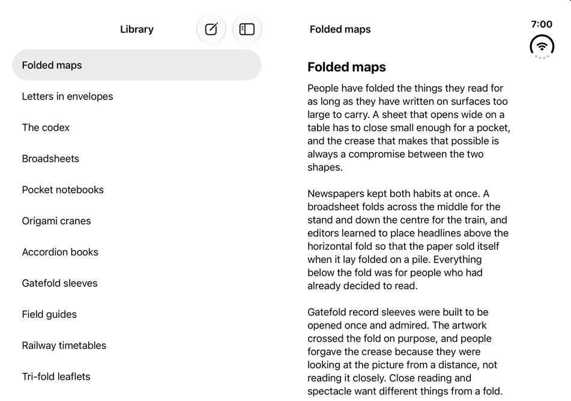
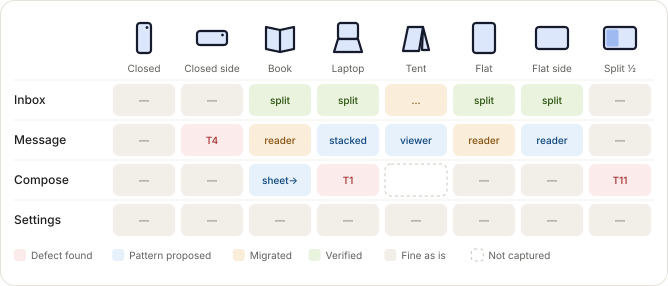

# Foldsmith

<p align="center">
  
  <br>
  <sub>Image © Apple Inc. All rights reserved. Reproduced from Apple's <a href="https://developer.apple.com/iphone-duo/">iPhone Duo developer page</a> solely for the purpose of identification.</sub>
</p>

Layout patterns for apps on iPhone Duo, Apple's foldable, measured on the simulator in every pose; detectors that find
the layouts that break on the fold; and a Claude Code plugin that adapts a whole app hands-free and proves every pose
with screenshots.

iPhone is a trademark of Apple Inc., registered in the U.S. and other countries, and iPhone Duo is a trademark of Apple
Inc. Foldsmith is independent and is not affiliated with, sponsored by, or endorsed by Apple Inc.

<p align="center">
  
  <br>
  <sub>The catalog's Fold-aligned split in book pose, captured on the iPhone Duo simulator: the boundary on the fold.</sub>
</p>

## Start here
| You want to | Go to |
|---|---|
| adapt your app with Claude Code | [Hands-free migration](#hands-free-migration-with-claude-code) below, and [the plugin's README](plugins/foldsmith/README.md) |
| copy a layout into your app | [`Sources/Patterns/`](Sources/Patterns/): one copy-in Swift file per pattern (to keep Fold-aligned split's two panes upright too, copy `FoldAlignedTiledSplit.swift` with `FoldAlignedSplit.swift`) |
| read a pattern: when to use it, what it does in each pose, and why | [Fold-aligned split](patterns/fold-aligned-split.md), [Even grid](patterns/even-grid.md), [Arrangement](patterns/arrangement.md), [Reflowing columns](patterns/reflowing-columns.md) |
| find which pattern a screen needs | [the decision table](patterns/DECISION-TABLE.md) (and the defect classes in [the taxonomy](patterns/TAXONOMY.md)) |
| check a claim | [`EVAL.md`](EVAL.md) (the gates and where each stands), [`verification/`](verification/) (the captures, the comparisons with Apple's apps, the three migrations) |
| see how it was built | [`docs/history/`](docs/history/) (the working log, every departure from the plan, the first plan) |

## Status
On 2026-10-29: four patterns, each with a reference implementation, a pose matrix captured in all seven poses and
detector results. Three of them, Fold-aligned split, Even grid and Arrangement, are compared with Apple's apps:
Settings captured on the simulator, and Fitness, Podcasts and Accessibility Reader in frames from Apple's tech talk
111463, renders that show two or three poses (`EVAL.md` §7 has the gates and where each pattern differs from Apple's
app). The fourth, Reflowing columns, has no Apple app to compare with yet.

The plugin's skill was run on three open-source apps (`verification/runs/`): IceCubesApp's five logged-out screens
and NetNewsWire's five are verified in every pose (a detector added after NetNewsWire's run finds its Reader View
button in 8 cells, not fixed); Wikipedia's run finished 2 of its 11 screens and left 15 confirmed review items
unfixed. The detectors read any app through its accessibility tree.

## Hands-free migration with Claude Code
Install the `foldsmith` plugin, open your app's folder in Claude Code, and run `/foldsmith-start`. The bundled
`foldsmith-duo` skill takes the whole app from audit to verified without stopping to ask: it finds the screens,
captures each in all seven Duo poses, applies the catalog's patterns, and proves every pose with before/after shots.
It commits one screen at a time on a `duo-migration` branch, never pushes, and keeps `.duo/migration.json` current,
so a later session resumes where it stopped.

A pane beside the chat follows it: the live simulator, the screen × pose matrix, before and after for any screen and
pose, and what is done and what is left.

<p align="center">
  
  <br>
  <sub>The pane's matrix, from <code>/foldsmith demo</code> sample data. It follows the system's light or dark mode.</sub>
</p>

### Requirements
- macOS with Xcode 27.1 and the iOS 27.1 simulator runtime;
- one iPhone Duo simulator, for example `xcrun simctl create "iPhone Duo" com.apple.CoreSimulator.SimDeviceType.iPhone-Duo
  com.apple.CoreSimulator.SimRuntime.iOS-27-1`;
- [xcodegen](https://github.com/yonaskolb/XcodeGen) (`brew install xcodegen`), which generates the tap runner's, the
  catalog's and the probe's Xcode projects;
- Claude Code 2.1.308 or later (tested with 2.1.308; 2.1.236 and older reject the plugin's hooks), so run
  `claude update` first;
- the [iphone-duo-simulator-skill](https://github.com/WhitenWhiten/iphone-duo-simulator-skill) driver (`duo.py`),
  which the skill fetches at a fixed commit into `~/Library/Caches/duo-driver` when it is missing.

### Install
At the prompt of a Claude Code terminal session:

```
/plugin install foldsmith --marketplace 3nchiridion/foldsmith
```

Answer `y` to add the marketplace, then pick a scope. From a shell:

```
claude plugin install foldsmith --marketplace 3nchiridion/foldsmith
```

If `--marketplace` is not offered, Claude Code is older than 2.1.308: run `claude update` first. To fetch only the
plugin and not the evidence (about 79 MB in all), add the marketplace with a sparse checkout, then install:
`claude plugin marketplace add 3nchiridion/foldsmith --sparse .claude-plugin plugins`, then
`claude plugin install foldsmith@foldsmith`.

In the desktop app, where `/plugin` does not run: click + next to the prompt box, then Plugins, Add marketplace with
`3nchiridion/foldsmith`, then Add plugin. Run `/foldsmith demo` to preview the pane with sample data.

## Build and test
With Xcode 27.1 and xcodegen:
- `swift test`: the detectors on the committed captures (G3), and the tests that hold each pattern to its captures;
- `swift run duo-detect <dir>`: the detectors on a folder of frame records or accessibility snapshots;
- `python3 scripts/sync-skill-references.py --check`: the skill's generated references match their sources (run it
  without `--check` after editing `patterns/`, `Sources/` or `SKILL.md`);
- `cd Examples/Catalog && xcodegen generate && open Catalog.xcodeproj`, then run the catalog on the iPhone Duo
  simulator;
- `gh workflow run ci.yml -f goldens=true`: G2, every config captured in every pose and compared with the goldens.

## Repository map
| Folder | What it holds |
|---|---|
| `patterns/` | the pattern pages, the decision table, the defect taxonomy, and how the patterns were chosen (`CLUSTERING.md`) |
| `Sources/Patterns/` | the reference implementations, one copy-in file per pattern |
| `Sources/DuoDetectors/`, `Sources/duo-detect/` | the pose model and the detectors (T1, T2, T4, T5, T7, T10, T14, T15: the defect classes in `patterns/TAXONOMY.md`), for the catalog's records or any app's accessibility tree: `swift run duo-detect <dir>`; `Package.swift` at the root builds them |
| `Sources/DuoPoseTesting/`, `Tests/` | a harness for app tests, and the tests that hold the patterns to their captures |
| `Examples/Catalog/` | the catalog app: each reference beside the defect it fixes; the pose matrices are captured from it |
| `plugins/foldsmith/` | the plugin: the skill, `/foldsmith-start`, and the pane |
| `skills/foldsmith-duo/` | the skill on its own: `SKILL.md`, its references (generated from `patterns/`) and tools |
| `verification/` | `matrices/` (the goldens), `oracle/` (against Apple's apps), `accessibility/` (the catalog read through XCTest), `runs/` (the three migrations), `ab/` (a blind A/B, set aside) |
| `raw/` | primary material: notes on Apple's talks and docs, SDK notes, measured metrics, screenshots of Apple's and the corpus apps, developer questions, the corpus manifest and defects |
| `scripts/` | capture (catalog, corpus apps, Apple apps), matrix compose and diff, the progress file, skill sync, redaction |
| `Probe/`, `Tap/` | DuoProbe, which logged each pose's geometry; DuoTapUITests, which taps an app on the shut Duo and holds it while the host folds and shoots |
| `docs/` | `history/` (the working log `STATUS.md`, `DEVIATIONS.md`, the first plan `MAC-PHASE.md`) and images |
| `.claude-plugin/` | `marketplace.json`: this repository as the Claude Code marketplace `foldsmith`, listing its one plugin `foldsmith` |
| `.github/workflows/` | `ci.yml`: the detector tests and builds (G1, G3) on pushes to main and on pull requests; G2 on manual dispatch |

`EVAL.md` at the root is the pre-registered contract: the gates, the rubric, and in §7 where each gate stands.

## Contributing
A problem with the plugin: open an issue with the app, the pose and its `.duo/migration.json`. A corpus app: add its
repository and commit to `raw/corpus/manifest.txt` and its findings to `raw/corpus/defects.csv`, with evidence under
`raw/corpus/evidence/<app>/`. A migration case study: a `verification/runs/<app>/` folder like the three there
(README, REPORT.md, audit.md, migration.json, the patch with its licence). Edits to `patterns/` or `Sources/` need
`python3 scripts/sync-skill-references.py` rerun.

## License
MIT (`LICENSE`) for everything this project wrote, code and text. Microsoft sources under `raw/precedent/ms-source`
keep their MIT license. Three patches change other projects and keep their licenses, whose texts are next to them:
`verification/runs/IceCubesApp/IceCubesApp.patch` (AGPL-3.0, as IceCubesApp is),
`verification/runs/Wikipedia/Wikipedia.patch` (MIT, Wikimedia Foundation) and
`verification/runs/NetNewsWire/NetNewsWire.patch` (MIT, Brent Simmons).

The iPhone Duo photo at the top is Apple's, shown from Apple's developer page and not stored here. Screenshots under `raw/corpus/evidence/`, `raw/apple-apps/` (Apple's Safari and Settings; all but the project's own `_probe/`) and
`verification/ab/baseline/` show other apps and the content those apps display. They are not covered by `LICENSE`: the
apps, their logos and trademarks and the content belong to their owners. Wikipedia's text is by Wikipedia's
contributors under CC BY-SA 4.0, and its images are under the terms on their file pages. The shots are here only as
evidence of how the layouts behave, stored as 256-colour PNGs. Apple's talks and documentation are cited by link and
time; `raw/apple-docs/` keeps notes on them (chapter maps, API names, short code listings as published, close
paraphrase), not transcripts or frames.
