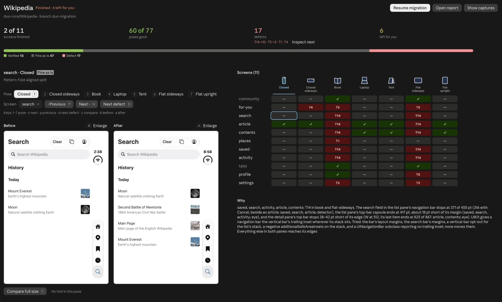
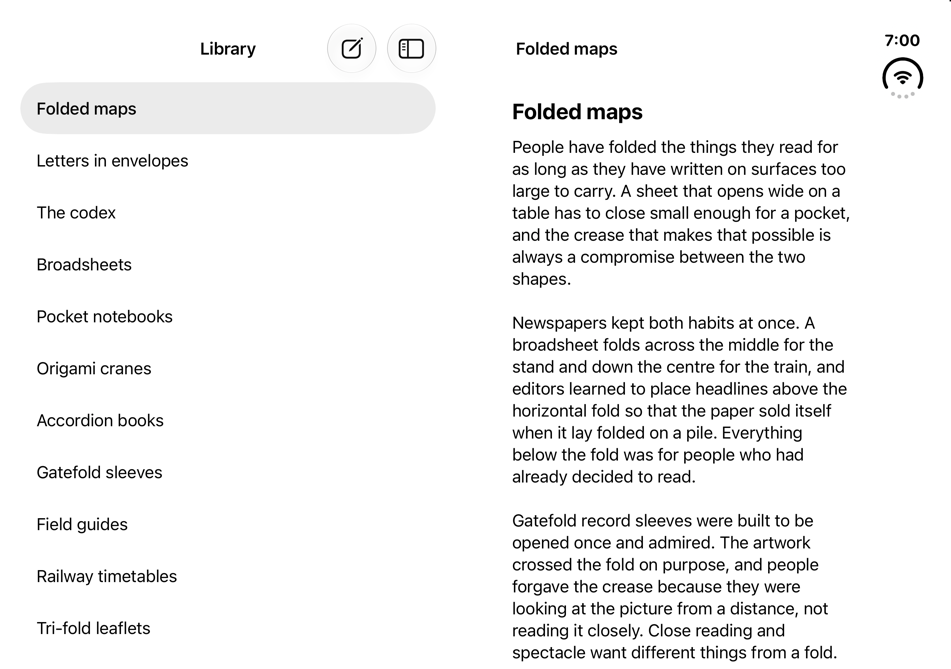

# Foldsmith

Claude Code skill and plugin for iPhone Duo: hands-free migration with measured layout patterns, checked in every pose on the simulator.

<!-- DEMO: 45–60s screen recording of /foldsmith-start on NetNewsWire → matrix fills → before/after on the fold. docs/assets/demo.gif linked to demo.mp4 -->

<p align="center">
  
  <br>
  <sub>The pane beside the chat, following the skill's hands-free run on Wikipedia's iOS app. That run did not pass review: the pane counts what the captures show, and <a href="https://github.com/3nchiridion/foldsmith-evidence/tree/main/verification/runs/Wikipedia">its report</a> lists 2 medium and 6 low regressions they do not. Screens from the Wikipedia app (MIT); its articles and images belong to their authors.</sub>
</p>

iPhone is a trademark of Apple Inc., registered in the U.S. and other countries, and iPhone Duo is a trademark of Apple
Inc. Foldsmith is independent and is not affiliated with, sponsored by, or endorsed by Apple Inc.

## Why now
- **The App Store marks apps that are ready.** Submit iPhone Duo screenshots and the product page shows a badge telling
  people the app is optimized for iPhone Duo ([Apple Developer: Prepare](https://developer.apple.com/iphone-duo/prepare/));
  Apple calls it the Made for iPhone Duo badge
  ([Newsroom, Oct 22, 2026](https://www.apple.com/newsroom/2026/10/developers-bring-incredible-new-app-experiences-to-iphone-duo/)).
- **The screenshots become required.** Starting April 2027, apps submitted to the App Store must include iPhone Duo
  screenshots ([Apple Developer News, Oct 5, 2026](https://developer.apple.com/news/?id=kkphp5qo); App Store Connect
  Help scopes it to apps built with the iOS 27.1 SDK or later:
  [screenshot specifications](https://developer.apple.com/help/app-store-connect/reference/app-information/screenshot-specifications/)).
  Foldsmith exports them from its captures ([App Store screenshots](#app-store-screenshots)).

## What makes it different
- **Detectors that read any app.** Eight defect classes, six of them seen in real apps so far (a pane boundary off the
  fold, text across it, a bar item stranded beside the vertical bar, state lost on the fold, …) found from an app's
  accessibility tree on the simulator, in every pose: [`Sources/DuoDetectors/`](Sources/DuoDetectors/), the classes in [the taxonomy](patterns/TAXONOMY.md),
  and the catalog read through XCTest, where they agree with its own records in all 119 captures
  ([`verification/accessibility/`](https://github.com/3nchiridion/foldsmith-evidence/tree/main/verification/accessibility)).
- **Seven-pose matrices, set against Apple's own apps.** Each pattern is captured in all seven poses
  ([the matrices](docs/images/matrices/)), and three of the four are compared with the Apple app that does the same
  thing, in the poses Apple shows it in: Settings on the simulator (six poses); Fitness (two), Podcasts and Accessibility
  Reader (three) in Apple's tech-talk frames. Where they differ is written down ([`verification/oracle/`](https://github.com/3nchiridion/foldsmith-evidence/tree/main/verification/oracle)).
- **Three real migrations, each reviewed.** The skill adapted NetNewsWire and IceCubesApp (five screens each, logged
  out for IceCubesApp), ending with no detector finding in any pose: 19 and 8 cells fixed and verified, the rest fine
  as they were. An independent review afterwards confirmed 7 items in IceCubesApp, none a regression (its signed-in
  app was not run), and 15 in NetNewsWire, 9 of them regressions: two high (the change does not build with the Xcode
  its CI uses; Mark All as Read closes the article on the inner display), most from its three-level feeds change, the
  kind a hands-free run now proposes instead of making. It also ran on Wikipedia, which did not pass review (2 of 11
  screens; its last check found 2 medium and 6 low regressions and 2 incomplete fixes). None of these is fixed; each
  run lists them with the detectors' findings before and after, the report and the patch ([`verification/runs/`](https://github.com/3nchiridion/foldsmith-evidence/tree/main/verification/runs)).

<p align="center">
  
  <br>
  <sub>The catalog's Fold-aligned split in book pose, captured on the iPhone Duo simulator: the boundary on the fold.</sub>
</p>

## Install
In a Claude Code terminal session, for the pane and `/foldsmith-start` (in the desktop app: + next to the prompt box,
then Plugins, Add marketplace `3nchiridion/foldsmith`):

```
/plugin install foldsmith --marketplace 3nchiridion/foldsmith
```

In Codex, Cursor, GitHub Copilot, Gemini CLI or any agent that reads Agent Skills, for the skill alone:

```
npx skills add 3nchiridion/foldsmith
```

Either needs macOS with Xcode 27.1 and an iPhone Duo simulator ([Requirements](#requirements)). More ways in:
[the plugin, step by step](#installing-the-plugin) and [other agents](#other-agents).

## Start here
| You want to | Go to |
|---|---|
| see what your app needs on the Duo, changing nothing | `/foldsmith-audit`: [Audit first](#audit-first-foldsmith-audit) |
| adapt your app with Claude Code | [Hands-free migration](#hands-free-migration-with-claude-code) below, and [the plugin's README](plugins/foldsmith/README.md) |
| copy a layout into your app | [`Sources/Patterns/`](Sources/Patterns/): one copy-in Swift file per pattern (to keep Fold-aligned split's two panes upright too, copy `FoldAlignedTiledSplit.swift` with `FoldAlignedSplit.swift`) |
| read a pattern: when to use it, what it does in each pose, and why | [Fold-aligned split](patterns/fold-aligned-split.md), [Even grid](patterns/even-grid.md), [Arrangement](patterns/arrangement.md), [Reflowing columns](patterns/reflowing-columns.md) |
| find which pattern a screen needs | [the decision table](patterns/DECISION-TABLE.md) (and the defect classes in [the taxonomy](patterns/TAXONOMY.md)) |
| check a claim | [`EVAL.md`](EVAL.md) (the gates and where each stands), [`verification/`](https://github.com/3nchiridion/foldsmith-evidence/tree/main/verification/) (the captures, the comparisons with Apple's apps, the three migrations) |
| see how it was built | [`docs/history/`](docs/history/) (the working log, every departure from the plan, the first plan) |

## Status
On 2026-10-29: four patterns, each with a reference implementation, a pose matrix captured in all seven poses and
detector results. Three of them, Fold-aligned split, Even grid and Arrangement, are compared with Apple's apps:
Settings captured on the simulator, and Fitness, Podcasts and Accessibility Reader in frames from Apple's tech talk
111463, renders that show two or three poses (`EVAL.md` §7 has the gates and where each pattern differs from Apple's
app). The fourth, Reflowing columns, has no Apple app to compare with yet.

The plugin's skill was run on three open-source apps ([`verification/runs/`](https://github.com/3nchiridion/foldsmith-evidence/tree/main/verification/runs/)): IceCubesApp's five logged-out screens
and NetNewsWire's five ended with no detector finding in any pose (8 and 19 cells fixed and verified, the rest fine as
they were), and an independent review then confirmed 7 items in IceCubesApp (no regression; its logged-in app was not
run) and 15 in NetNewsWire (9 regressions, two of them high). Wikipedia's run finished 2 of its 11 screens and did not
pass review: its last check found 2 medium and 6 low regressions and 2 incomplete fixes. None is fixed. The detectors
read any app through its accessibility tree.

## Hands-free migration with Claude Code
Install the `foldsmith` plugin and open your app's folder in Claude Code. Try `/foldsmith-audit` first: it changes
nothing. `/foldsmith-start` then adapts the app, taking up where the audit stopped.

### Audit first: `/foldsmith-audit`
`/foldsmith-audit [app folder]` runs the [preflight](#preflight), captures every screen in every pose before any change,
runs the detectors, looks at every shot and classifies each screen. It writes `.duo/audit.md` (the defect classes per
screen and pose, the classification and why) and `.duo/PLAN.md` (per screen, the pattern and the fix, local or
structural, with the navigation routes a structural one would touch), and exports the
[App Store set](#app-store-screenshots) from the cells that are already fine. It changes no code and makes no branch
and no commit. The progress file ends at phase `classify`, so the pane shows the audit and `/foldsmith-start` takes it
up later without repeating it. A clean detector table is not a pass: a defect the shot shows and the detectors miss is
still a finding.

### The migration: `/foldsmith-start`
`/foldsmith-start [app folder] [--structural]` runs the bundled `foldsmith-duo` skill, which takes the whole app from
audit to verified without stopping to ask: after the preflight it finds the screens, captures each in all seven Duo
poses, applies the catalog's patterns, and checks every pose with before/after shots. Hands-free it makes local
changes only, which run only where the phone has a fold, add no container and change no navigation; a structural one
(a container where the app has none, rerouted navigation, a change on every device) it proposes in `.duo/PLAN.md` with
the navigation routes it would touch, and makes when you run `/foldsmith-start --structural`. It commits one screen at
a time on a `duo-migration` branch, never pushes, and keeps `.duo/migration.json` current, so a later session resumes
where it stopped, from an audit's progress file too. Its report step exports the App Store set from the cells that
end verified or were fine as they were.

A pane beside the chat follows it, as at the top of this page: the run's figures, the screen × pose matrix, before
and after for any screen and pose (enlarged to the pane's width on a press), the live simulator, and what is done and
what is left. `/foldsmith demo` shows it with sample data.

### App Store screenshots
The audit and the migration's report step run the skill's `tools/appstore.py`; by hand, from the app's folder:
`python3 <skill folder>/tools/appstore.py [--kind after|before] [--file .duo/migration.json] [--out .duo/appstore]`.
- Per screen it takes one shot for each size App Store Connect lists for iPhone Duo: the outer display 1398 × 2034
  (`closed`) and 2034 × 1398 (`closed-sideways`), the inner display 2007 × 2853 (`flat-upright`, else `laptop`) and
  2853 × 2007 (`book`, else `flat-sideways`).
- It uses only cells that are verified or unchanged (unchanged only, for an audit's before shots), with a clean
  detector table and no open issue in that pose, at exactly that size. It never resizes.
- It flattens each shot with macOS's `sips` to a JPEG with no alpha channel, then writes
  `.duo/appstore/<size>/NN-<screen>-<pose>.jpg` and a README listing each file and each pose passed over, with the
  reason.
- The output is kept out of git (`.git/info/exclude`), and nothing is uploaded. A rerun replaces only what it wrote:
  it stops, changing nothing, at a `README.md` in the output folder that it did not write, and refuses an output folder
  that is your app's folder or the repository's top.
- Check every image for personal content and the status bar before you upload it: the clock is not overridden.

### Screens that need your own login
The run never logs in and never types credentials. For a screen behind a login it first tries the app's own UI-test
launch arguments and mock or demo modes. A screen it still cannot reach waits in what is left as `needs sign-in`: sign
in on the Duo simulator yourself, then run `/foldsmith-start` again. On that resume it checks those screens again and
carries on hands-free, without reinstalling the app (which would sign you out). Their shots show your own content, so
they stay in `.duo/captures/`, out of git.

### Requirements
- macOS with Xcode 27.1 and the iOS 27.1 simulator runtime;
- a simulator on that runtime whose name contains "Duo" (the driver drives only those), for example
  `xcrun simctl create "iPhone Duo" com.apple.CoreSimulator.SimDeviceType.iPhone-Duo com.apple.CoreSimulator.SimRuntime.iOS-27-1`;
  Foldsmith never creates one;
- python3 3.9 or later (Xcode's command line tools include it);
- `rg` (ripgrep); in Claude Code its own stands in;
- 5 GB free on the home volume, 10 to be safe (a full capture with two builds has taken about 10);
- your app in a git repository with nothing uncommitted outside `.duo/`, since the run commits on a branch;
- Claude Code 2.1.308 or later for the pane and the commands (tested with 2.1.308; 2.1.236 and older reject the
  plugin's hooks), so run `claude update` first.

Nothing else to install, and nothing is downloaded: no xcodegen (the tap runner's Xcode project is committed, and
`xcodebuild` builds it), the simulator driver `duo.py` ships with the skill (`tools/driver/`, MIT, unchanged from
[iphone-duo-simulator-skill](https://github.com/WhitenWhiten/iphone-duo-simulator-skill) at commit 60cdda2), and
the App Store export uses macOS's built-in `sips`.

### Preflight
Every audit and migration starts with the skill's `tools/preflight.sh <app folder>`, which checks all of the above
read-only and prints each check as `ok`, `warn`, `note` or `missing`, with the exact command that
fixes it. It installs, creates, renames and boots nothing: the fixes are yours to run, and while anything is missing
the run stops with that list. When nothing is, it writes `.duo/env` (the simulator, the bundled driver and, once
built, the tap runner; kept out of git) for the tools to read, and prints the one `xcodebuild` line that builds the
tap runner the first time (about 10 s). Its fix for uncommitted changes leaves `.duo/` alone, so an audit's progress
file and captures stay where `/foldsmith-start` looks for them. Run it yourself to see where your Mac stands before a
first run, in your app's folder; the plugin keeps the skill under `~/.claude/plugins/cache/`:

```
bash "$(ls -dt ~/.claude/plugins/cache/*/foldsmith/*/skills/foldsmith-duo | head -1)/tools/preflight.sh" .
```

### Installing the plugin
At the prompt of a Claude Code terminal session:

```
/plugin install foldsmith --marketplace 3nchiridion/foldsmith
```

Answer `y` to add the marketplace, then pick a scope. From a shell:

```
claude plugin install foldsmith --marketplace 3nchiridion/foldsmith
```

If `--marketplace` is not offered, Claude Code is older than 2.1.308: run `claude update` first.

In the desktop app, where `/plugin` does not run: click + next to the prompt box, then Plugins, Add marketplace with
`3nchiridion/foldsmith`, then Add plugin. Run `/foldsmith demo` to preview the pane with sample data.

### Other agents
The skill, `foldsmith-duo`, needs no Claude Code: its tools are shell, Python and Swift, and its progress file is plain
JSON. Only the pane, `/foldsmith-audit` and `/foldsmith-start` are Claude Code's. From a shell:

```
npx skills add 3nchiridion/foldsmith                     # asks which agents; -g installs for every project
gh skill install 3nchiridion/foldsmith foldsmith-duo     # GitHub CLI 2.90 or later
```

Or copy `skills/foldsmith-duo/` by hand into one of:
- `~/.claude/skills/` (every project) or `.claude/skills/` in your app: Claude Code;
- `.agents/skills/` in your app, or `~/.agents/skills/`: Codex, GitHub Copilot, Gemini CLI, OpenCode, Amp, Cursor;
- `.cursor/skills/` in your app, or `~/.cursor/skills/`: Cursor.

Then ask your agent to audit the app for iPhone Duo (it changes nothing) or to adapt it. Codex can also install the
plugin from this repository, whose `.claude-plugin/marketplace.json` it reads: `codex plugin marketplace add
3nchiridion/foldsmith`, then `codex plugin add foldsmith@foldsmith`. Only the skill comes through: Codex skips the
pane's hooks file with a startup warning, and leaves out `/foldsmith-start` and `/foldsmith-audit`, whose prompts take
an argument (worked out from Codex 0.166's source; not yet tried end to end).

## Build and test
With Xcode 27.1 and xcodegen:
- `swift test`: the detectors on the committed captures' frame records and accessibility snapshots (`Tests/Fixtures/`,
  G3), and the tests that hold each pattern to its captures;
- `swift run duo-detect <dir>`: the detectors on a folder of frame records or accessibility snapshots;
- `python3 scripts/sync-skill-references.py --check`: the skill's generated references and its copies of the tools
  match their sources (run it without `--check` after editing `patterns/`, `Sources/`, `scripts/`, `Tap/`,
  `third_party/` or `SKILL.md`);
- `python3 -m unittest discover -s scripts -p 'test_*.py'`: the progress file's checks; the preflight (and a resume
  after a skill update), the captures' lock, signals, disk guard, resume and missing cells (a skip, a failed shot, no
  snapshot), and a capture killed outright, with stand-ins for `xcrun`, `xcodebuild`, `df` and `duo.py` (no simulator);
  the App Store export where `sips` is; and the route inventory where `rg` is installed;
- after changing `Tap/project.yml`, or adding or removing a file in `Tap/DuoTapUITests/`: `cd Tap && xcodegen
  generate` with the xcodegen in `Tap/.xcodegen-version`, then the sync script, and commit the project with them; CI
  regenerates it and fails on any difference (and skips, with a warning, on another xcodegen version);
- `cd Examples/Catalog && xcodegen generate && open Catalog.xcodeproj`, then run the catalog on the iPhone Duo
  simulator;
- `gh workflow run ci.yml -f goldens=true`: G2, every config captured in every pose and compared with the goldens in
  [foldsmith-evidence](https://github.com/3nchiridion/foldsmith-evidence) (locally: check it out beside this repository, or set `FOLDSMITH_EVIDENCE`).

## Repository map
| Folder | What it holds |
|---|---|
| `patterns/` | the pattern pages, the decision table, the defect taxonomy, and how the patterns were chosen (`CLUSTERING.md`) |
| `Sources/Patterns/` | the reference implementations, one copy-in file per pattern |
| `Sources/DuoDetectors/`, `Sources/duo-detect/` | the pose model and the detectors (T1, T2, T4, T5, T7, T10, T14, T15: the defect classes in `patterns/TAXONOMY.md`), for the catalog's records or any app's accessibility tree: `swift run duo-detect <dir>`; `Package.swift` at the root builds them |
| `Sources/DuoPoseTesting/`, `Tests/` | a harness for app tests, and the tests that hold the patterns to their captures (their frame records, accessibility snapshots and the three runs' progress files in `Tests/Fixtures/`, packed by `scripts/pack-fixtures.py`) |
| `Examples/Catalog/` | the catalog app: each reference beside the defect it fixes; the pose matrices are captured from it |
| `plugins/foldsmith/` | the plugin: the skill, `/foldsmith-audit`, `/foldsmith-start`, and the pane |
| `skills/foldsmith-duo/` | the skill on its own: `SKILL.md`, its references (generated from `patterns/`) and tools |
| [foldsmith-evidence](https://github.com/3nchiridion/foldsmith-evidence) | the evidence, in a repository of its own: `verification/` (`matrices/`, the goldens; `oracle/`, against Apple's apps; `accessibility/`, the catalog read through XCTest; `runs/`, the three migrations; `ab/`, a blind A/B, set aside) and `raw/` (notes on Apple's talks and docs, SDK notes, measured metrics, screenshots of Apple's and the corpus apps, developer questions, the corpus manifest and defects) |
| `scripts/` | the preflight (`preflight.sh`), capture (catalog, corpus apps, Apple apps), matrix compose and diff, the progress file, the route inventory for a structural plan (`routes.sh`), the App Store export (`appstore.py`), skill sync, redaction |
| `Probe/`, `Tap/` | DuoProbe, which logged each pose's geometry; DuoTapUITests, which taps an app on the shut Duo and holds it while the host folds and shoots (its Xcode project is committed, made by xcodegen from `Tap/project.yml`) |
| `third_party/duo-driver/` | the simulator driver the skill bundles (`duo.py`, `duo_fold.c`): MIT, from WhitenWhiten/iphone-duo-simulator-skill at commit 60cdda2, unchanged; its README gives the upstream, the commit, the hashes and what it runs |
| `docs/` | `history/` (the working log `STATUS.md`, `DEVIATIONS.md`, the first plan `MAC-PHASE.md`) and images (`images/matrices/`: each pattern's pose matrix, small) |
| `.claude-plugin/` | `marketplace.json`: this repository as the Claude Code marketplace `foldsmith`, listing its one plugin `foldsmith` |
| `.github/workflows/` | `ci.yml`: the detector tests and builds (G1, G3) and a check that the committed tap project matches its spec, on pushes to main and on pull requests; G2 on manual dispatch |

`EVAL.md` at the root is the pre-registered contract: the gates, the rubric, and in §7 where each gate stands.

## Contributing
A problem with the plugin: open an issue with the app, the pose and its `.duo/migration.json`. A corpus app or a
migration case study goes to [foldsmith-evidence](https://github.com/3nchiridion/foldsmith-evidence): the corpus app's repository and commit in `raw/corpus/manifest.txt`
and its findings in `raw/corpus/defects.csv`, with evidence under `raw/corpus/evidence/<app>/`; a case study as a
`verification/runs/<app>/` folder like the three there (README, REPORT.md, audit.md, migration.json, the patch with its
licence). Edits to `patterns/` or `Sources/` need `python3 scripts/sync-skill-references.py` rerun.

## License
MIT (`LICENSE`) for everything here, code and text, except `third_party/duo-driver/`, the community simulator driver,
which keeps its own MIT licence and copyright (`third_party/duo-driver/LICENSE`). The rest of the third-party material
is in [foldsmith-evidence](https://github.com/3nchiridion/foldsmith-evidence), each piece with its licence beside it: Microsoft's sources (MIT), three patches that keep their projects' licences (IceCubesApp's AGPL-3.0,
Wikipedia's and NetNewsWire's MIT), and screenshots of other apps, which belong to their owners.
