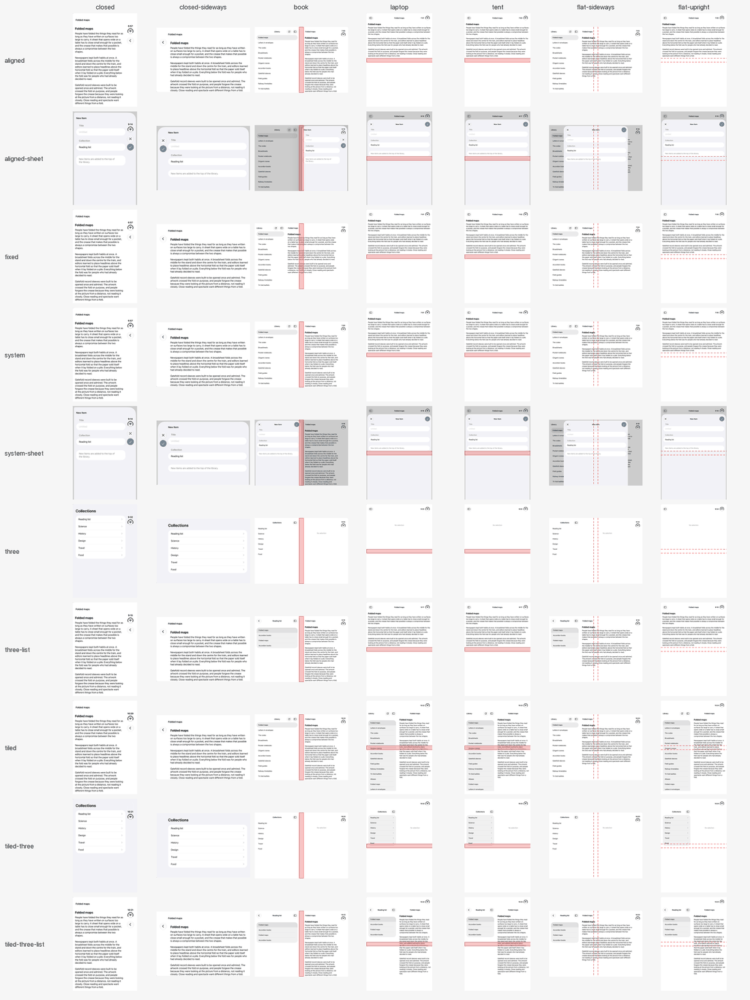

# Fold-aligned split

> A list and its detail: one pane on the outer display, two panes on the sideways inner display with the boundary on the fold when the phone is folded like a book, and sheets on the trailing half.

**Pose matrix**: generated by `Examples/Catalog` with `scripts/capture-catalog.sh`, never hand-made. Rows: the
reference (`aligned`, and `aligned-sheet` with the New Item sheet up), the plain system split (`system`,
`system-sheet`), the "before" variant (`fixed`, a 320 pt sidebar, NetNewsWire's shape), three levels in two panes
(`three` at the top level, `three-list` with a collection and its first article picked), and the same on
`FoldAlignedTiledSplit`, which keeps two panes upright (`tiled`, `tiled-three`, `tiled-three-list`). The red band is the active
division; a dashed outline is the inactive one.

Citations: `[tt-<id> m:ss]` is an Apple tech talk at that chapter (notes in [`raw/apple-docs/`](https://github.com/3nchiridion/foldsmith-evidence/tree/main/raw/apple-docs/)), `[hig …]` the HIG
article, `[apple-apps/<app>/<pose>]` a screenshot in [`raw/apple-apps/`](https://github.com/3nchiridion/foldsmith-evidence/tree/main/raw/apple-apps/), `[metrics:<pose>]` [`raw/metrics.json`](https://github.com/3nchiridion/foldsmith-evidence/blob/main/raw/metrics.json);
T-codes are the defect classes in `patterns/TAXONOMY.md`, P-numbers the patterns in `patterns/DECISION-TABLE.md`,
and G1–G6 the gates in `EVAL.md`.

## Context
Hierarchical content: a list whose items open into a detail. Decision table rows `hierarchical / viewing` and
`hierarchical / editing`. Corpus: NetNewsWire's split boundary at about 323 pt in book, the article pane across the
fold [[raw/corpus/defects.csv](https://github.com/3nchiridion/foldsmith-evidence/blob/main/raw/corpus/defects.csv), T14]. Apple: Settings moves its split onto the fold in book and drops back to a 320 pt
sidebar when flat [apple-apps/settings/book, flat-sideways]; Notes equalizes its panes when folded [hig alt text].

## Forces
- Apps set a sidebar width to make the list readable. On the Duo any width, even one equal to the fold's edge, stops
  the system from putting the boundary on the fold.
- Held upright, the open phone is a 669 pt window taller than wide. Settings keeps both panes there; SwiftUI's
  split view shows the detail and puts the sidebar behind a button, as on an iPad in portrait.
- Sheets are placed on the leading half by default in book, over the list, while Apple sends alerts to the trailing
  side [tt-111463 4:00].
- Switching layout on every fold risks the sidebar's state: a pose-dependent modifier rebuilds the sidebar view.

## Solution

| Pose | Panes (window pt) | Bars | Sheets | Source |
|---|---|---|---|---|
| closed | one: the detail (or the list), 0–382 | vertical, trailing | full width of the safe area, 8–382 | [hig split views; apple-apps/settings/closed] |
| closed-sideways | one, 84–678 | vertical, leading | 84–670 | [metrics:closed-sideways] |
| book | sidebar 0–455.7, detail 495.5–867.2: the boundary is the division | detail's bar vertical, trailing | trailing half, 483.5–867.2 | [hig reserved regions; apple-apps/settings/book; tt-111463 4:00] |
| laptop, tent | `FoldAlignedSplit`: the detail, 0–669, the sidebar one tap away (**differs from Settings**, which tiles a ≈ 250 pt sidebar). `FoldAlignedTiledSplit`: sidebar 0–320, detail 320–669, as Settings | horizontal | 8–661, y 82–917: across the horizontal fold | [apple-apps/settings/laptop; tt-111466 9:28] |
| flat-sideways | sidebar 0–320, detail 320–867: leading pane narrower, the inactive division ignored | vertical, trailing | centred, 149–802 | [apple-apps/settings/flat-sideways; hig alt text Notes open] |
| flat-upright | as laptop, for both | horizontal | 8–661 | [apple-apps/settings/flat-upright] |

The rule: use `NavigationSplitView` and set no column width; when a vertical division is active, present sheets with
`presentationPlacement(.trailing)`, otherwise `.automatic`. The system does the fold alignment itself. With three
levels (sidebar, list, detail) the panes are still two: the sidebar and the detail when the phone is unfolded from the
sidebar, the list in the sidebar's place once an item is picked (the catalog's choice: unfolding from the sidebar
keeps the sidebar on screen, beside the detail): a two-column `NavigationSplitView` whose sidebar column holds a
`NavigationStack` (the catalog's `three` and `three-list`). In book the collections, or a collection's articles, take
0–455.7 pt and the detail 495.7–867 pt; flat sideways 0–320 and 320–867 pt, as with two levels. Upright the split
shows the detail alone, as it does with two levels (below); at the top level that detail is empty, and the
accessibility detectors call it T7 across poses: the shut phone's collections are not on the inner display
([`verification/accessibility/`](https://github.com/3nchiridion/foldsmith-evidence/tree/main/verification/accessibility/)). UIKit below.

A `TabView` whose tabs sit in a sidebar on the inner display (`.sidebarAdaptable`) is this pattern already: the system
aligns that sidebar the same way, with no width set (IceCubesApp, measured: book 0–455.5 | 495.5–867 pt, flat sideways
≈ 0–280 | 280–867 pt [[verification/runs/IceCubesApp](https://github.com/3nchiridion/foldsmith-evidence/tree/main/verification/runs/IceCubesApp)]). Keep it, as a system container; the sheet rule still applies,
with `readsBookFold()` once on the window's root to set what `foldAwareSheetPlacement()` reads. Upright its tab's
content fills the window and the sidebar is a tap away, the same shortfall as `FoldAlignedSplit`'s;
`FoldAlignedTiledSplit` replaces a `NavigationSplitView`, not a `TabView`.

Upright, `FoldAlignedSplit` does not match the decision table's "two panes" [apple-apps/settings/laptop,
flat-upright]: `NavigationSplitView` overlays its sidebar at 669 pt wide whatever the settings (measured in the
catalog with the balanced style, every column visible, and a 250 pt or a 200–480 pt sidebar; forcing the sidebar
visible brings it up over a dimmed detail at launch). Settings is a UIKit split view that tiles.
`FoldAlignedTiledSplit` matches it (the catalog's choice, so both panes stay on screen upright as in Settings):
upright on the inner display, where the system draws no vertical bar, it is a two-column `UISplitViewController` with
`preferredSplitBehavior = .tile`, `minimumSecondaryColumnWidth = 320` and no column width, the sidebar and the detail
in hosting controllers (sidebar 0–320 pt, detail 320–669 pt in laptop, tent and flat-upright, measured in the
catalog's `tiled`, `tiled-three` and `tiled-three-list`). Everywhere else it is `FoldAlignedSplit`, because the
vertical bar comes only to bars SwiftUI's containers provide: tried as a UIKit split in every pose, the outer display
kept its back button in a horizontal top bar, since the system finds the vertical bar from the window's root view
controller down (`childForPreferredVerticalBarBehavior`) and SwiftUI's root does not hand it on to an embedded
controller. With three levels it keeps the collections beside the detail upright, so the top level is no longer an
empty detail (no T7). UIKit apps: see UIKit below.

## Consequences
- No control over the sidebar's width on the inner display. Lists with long rows wrap in the 320 pt flat sidebar.
- The sheet rule needs every sheet's content to carry the modifier (`foldAwareSheetPlacement()`); a sheet without it
  falls back to the leading half.
- In book both placements end 8 pt past the crease's centre, inside the division's 20 pt margin: the system's own
  sheet ends at 467.3 pt, the trailing one starts at 483.5 pt. The side is the defect, not the edge.
- Upright, `FoldAlignedSplit` keeps the list a tap away instead of beside the detail (see Solution).
- `FoldAlignedTiledSplit` swaps one container for the other between an upright inner pose and a pose with a vertical
  bar (book, flat sideways, the outer display), so the views in both panes are built again there. Keep what must
  survive the fold in the caller: the selection (passed in) and any path the sidebar navigates (checked: a collection
  opened on the outer display stayed open in every pose, upright included). Scroll positions start over, which the T7
  detector does not see (it compares what is on screen, not where a list was scrolled to).
- In laptop the system's sheet spans the horizontal fold (y 82–917 pt). Its form scrolls, which Apple exempts
  [tt-111466 9:28]; a fixed control placed in the middle of a sheet would be T1.
- An empty detail with a centred placeholder ("No selection") lands on the laptop fold (NetNewsWire, T1): put
  placeholders at the top of the pane (the catalog's sits at y 202–222 pt upright, clear of 455.5–495.5).
- Three levels upright on `FoldAlignedSplit`: unfolded at the top level, the person sees an empty detail with the
  collections one tap away (T7, measured). `FoldAlignedTiledSplit` keeps them beside it.
- A tab sidebar rebuilds its tab bar items whenever the vertical bar comes or goes, which is on every fold. IceCubesApp
  kept its logged-out tabs in an untitled sidebar-only `TabSection`: each rebuild showed the hidden Timeline tab for a
  moment, whose `onAppear` presented Add Account again over what the person was reading, and closing the phone from
  tent with the sidebar-only Settings tab selected crashed in `UITabBarController` (T7). Plain `Tab`s, as the app
  already used on iPhone, fixed both. Keep work out of a tab's `onAppear` that must not run twice, and test every fold
  with each tab selected.

## Known uses
- Apple: Settings, every inner pose ([`raw/apple-apps/settings/`](https://github.com/3nchiridion/foldsmith-evidence/tree/main/raw/apple-apps/settings/)).
- Corpus before: NetNewsWire, book ([`raw/corpus/evidence/NetNewsWire/launch-book-inner.png`](https://github.com/3nchiridion/foldsmith-evidence/blob/main/raw/corpus/evidence/NetNewsWire/launch-book-inner.png)); its sidebar width comes
  from `SceneCoordinator.swift`. The catalog's `fixed` variant reproduces it: sidebar 0–320, detail 320–847 pt.
- Corpus sheets on the leading half in book: IceCubesApp, Home Assistant, Signal, Firefox (T15). The catalog's
  `system-sheet` reproduces it: 8–467.3 pt.
- Corpus after: NetNewsWire, a UIKit split ([`verification/runs/NetNewsWire/`](https://github.com/3nchiridion/foldsmith-evidence/tree/main/verification/runs/NetNewsWire/)); IceCubesApp, a `TabView` sidebar with
  the sheet rule ([`verification/runs/IceCubesApp/`](https://github.com/3nchiridion/foldsmith-evidence/tree/main/verification/runs/IceCubesApp/)); Wikipedia, UIKit tabs with no split view, through a container of
  its own (Saved, Activity, Search) and the sheet rule ([`verification/runs/Wikipedia/`](https://github.com/3nchiridion/foldsmith-evidence/tree/main/verification/runs/Wikipedia/)). NetNewsWire's and
  IceCubesApp's ended with no finding in any pose, by the skill alone and with no independent review (a later detector
  finds NetNewsWire's Reader View button beside the vertical bar in 8 cells). Wikipedia's was reviewed four times and
  fixed in four rounds, and did not pass review: the top bars of both its panes still stop short of their edges (the
  list's search field at 371 of 455 pt), and the last review found routes that still miss the container (its README
  lists them).

## When not to use it
- Two views of equal standing that both need the full height (player and up-next, document and inspector):
  [**Arrangement**](arrangement.md) (P4); keep the navigation container outside it.
- A list whose detail is a small popover, not a pane: one list that scrolls across the fold.

## Reference implementation
[`Sources/Patterns/FoldAlignedSplit.swift`](../Sources/Patterns/FoldAlignedSplit.swift): one file, copy-in, no
dependency on this repository. `FoldAlignedSplit { List(…) } detail: { Detail(…) }`, and `.foldAwareSheetPlacement()`
on each sheet's content; an app whose split is a `TabView` sidebar puts `.readsBookFold()` on its window's root
instead of using `FoldAlignedSplit`. The fold query and `presentationPlacement` are gated with
`#available(iOS 27.1, *)`, and compiled only for iOS: Xcode 27.1's Mac Catalyst, visionOS and macOS SDKs have no
reserved regions, and `.trailing` is unavailable on visionOS and macOS, so a target that shares the file gets a plain
`NavigationSplitView` there (IceCubesApp's design-system package also builds for visionOS).

For two panes upright too: [`Sources/Patterns/FoldAlignedTiledSplit.swift`](../Sources/Patterns/FoldAlignedTiledSplit.swift),
copied with the file above. `FoldAlignedTiledSplit(selection: $selection) { List(…, selection: $selection) } detail: {
Detail(…) }`; with three levels, a sidebar that holds its own `NavigationStack` passes `sidebarNavigates: true`. Keep
the selection and the sidebar's path in the caller (they survive the switch between containers).

## UIKit (`UISplitViewController`)
Measured on NetNewsWire, a three-column UIKit split, in the hands-free run, not in the catalog
([`verification/runs/NetNewsWire/`](https://github.com/3nchiridion/foldsmith-evidence/tree/main/verification/runs/NetNewsWire/), the code in `NetNewsWire.patch`):
- **No column width.** When the window has a fold (`view.reservedRegions(kind: .division, options: .includeInactive)`
  is not empty), set all six `minimum…`, `maximum…` and `preferred…` `PrimaryColumnWidth` and
  `SupplementaryColumnWidth` to `UISplitViewController.automaticDimension`; keep the app's own widths where there is no
  fold. In book the system then puts the boundary on the fold: timeline 0–455, article from 495 pt.
- **Two panes upright.** With `preferredSplitBehavior = .tile` and `minimumSecondaryColumnWidth = 320` (iOS 26), the
  split tiles the list beside the detail in the 669 pt window (laptop, tent, flat-upright), as Settings does. With the
  system's own detail minimum it shows the detail alone, or the sidebar over a dimmed detail. Set the minimum before
  the split resolves its display mode: when it is created, if the split exists only where there is a fold; if it exists
  in every pose, in `viewWillLayoutSubviews` before calling `super`. Set after that pass (in `viewDidLayoutSubviews`),
  a first launch can keep the overlay, since later passes do not leave it (measured on fresh installs of the catalog:
  `tiled` in laptop came up as an overlay on 5 of 5 with the minimum set in `viewDidLayoutSubviews`, and tiled on 5 of
  5 with it set before the first layout).
- **Sheets.** `sheetPresentationController.preferredPlacement = .trailing` while a vertical division is active,
  `.automatic` otherwise: set it before `present`, and change sheets already up inside `animateChanges` when the fold
  changes. Gate it with `#available(iOS 27.1, *)` like the region query.
- **When to look again.** UIKit has no callback when the reserved regions change. Re-read them on every layout
  (`viewWillLayoutSubviews` for what the split's own layout depends on, such as the detail minimum above), and add a
  `UIHingeInteraction` whose handler calls `setNeedsLayout()`: a sheet presented on the cover moved to the trailing
  half when the phone was unfolded.
- **Placeholders.** Move an empty detail's placeholder into the upper part of its pane (NetNewsWire: 25 % of its
  height).
- **Three levels** (sidebar, list, detail). The two panes are the list pane and the detail; the list pane navigates
  the first two levels. Unfolded from the sidebar, the sidebar sits beside the detail (the catalog's choice, as
  above); a picked item pushes the list onto the list pane and Back returns to the sidebar. A triple-column split
  pairs only its supplementary column with the detail in `.oneBesideSecondary`, and a zero-width supplementary column
  fails a UIKit assertion. What works (NetNewsWire): while the window has a fold and the split is expanded, change the
  two navigation stacks, not the columns: the primary column's stack holds an empty controller and the supplementary
  column's holds the sidebar, with the list pushed on top once an item is picked; `displayModeButtonVisibility =
  .never`. Put the stacks back in `splitViewController(_:topColumnForCollapsingToProposedTopColumn:)` and answer from
  the app's own state (detail if one is open, else the list if an item is picked, else the sidebar): the proposal no
  longer says where the person was. Two things that do not work: moving the controllers between columns with
  `setViewController(_:for:)`, which UIKit applies only at the next rotation of the cover, popping it to the sidebar;
  and doing it in `viewWillTransition`, which a fold onto the cover does not call first and which loops with a sheet
  up. Forcing the sidebar visible instead brings it up as an overlay over a dimmed detail, which this page rejects.

## UIKit without a split view (tabs of navigation stacks)
Measured on Wikipedia, whose list tabs (Saved, Activity, Search) are navigation stacks in a `UITabBarController` and
push articles from 24 places ([`verification/runs/Wikipedia/`](https://github.com/3nchiridion/foldsmith-evidence/tree/main/verification/runs/Wikipedia/), `WMFFoldSplitContainerViewController` in
`Wikipedia.patch`), in the hands-free run and its four reviews:
- **A container, not a `UISplitViewController`.** A split view expands wherever the width is regular, so it would also
  split those tabs on an iPad and on the upright inner display, where the app has no finding. The container shows two
  panes only where the window has a vertical division (`includeInactive`: book and flat sideways): the tab's own stack
  ends where the fold begins, a detail stack starts where it ends and stops at the vertical bar's band. Elsewhere it is
  invisible and the tab's stack fills it. Closing the phone pushes the detail's screens back onto the list's stack;
  opening it moves them out again. The vertical bar goes with the detail while split
  (`childForPreferredVerticalBarBehavior`), so the list's own bar items move into its navigation bar at the top of the
  pane, as a system sidebar's do. Flat sideways it splits at the inactive division too, so nothing moves when the phone
  is then folded; the system's `NavigationSplitView` ignores an inactive division there (the table above: 0–320 |
  320–867). Both are clean; the container's way leaves the 40 pt band blank in the middle of a flat screen.
- **What the tab bar did for the stack, the container does.** `hidesBottomBarWhenPushed` and pop-to-root on a second
  tap work only for a navigation controller that is the tab: forward both from the tab bar controller's delegate, and
  decide the tab bar again on every change of tab, a programmatic one too (Wikipedia's carried a hidden tab bar into
  the next tab until the second review), move it with the push, pop or back swipe as the system does, and put it back
  when a swipe is cancelled. Touch the tab bar of a tab that is its own stack only to undo what you set.
- **The container changes the hierarchy on every device.** It wraps the tab on every iOS 27.1 device, split or not,
  so every walk that expects a navigation controller (`as? UINavigationController` on a tab or a presented controller,
  `viewControllers`) finds none. Wikipedia's state restoration stopped saving the open article and its theme pass
  stopped reaching Settings' pages, on every iOS 27.1 phone and iPad (second review). Find every walk, unwrap the
  container, and while split look for the open item in the detail stack.
- **A push from a detail page stacks on the detail.** Coordinators handed the list's navigation controller also push
  from inside a detail page. Replacing the detail's root then, as a selection from the list does, drops the parent page
  and its Back (Wikipedia's Settings sub-pages), and their pops land on the list and do nothing. Only a selection from
  the list replaces the detail.
- **Split only what the container can route.** A list whose pages navigate on their own, through coordinators that
  push and pop one stack, and that more than one route presents, needs its navigation rewritten before it can split.
  Wikipedia's Settings (about a dozen coordinators, a donation reminder that pops, two routes in) was split, broke all
  three, and was reverted: its rows still cross the fold (T5, in `todo`).
- **Cancel the bar's inset in both panes.** UIKit gives every screen of a navigation stack a trailing safe-area inset
  the width of the vertical bar (84 pt) whenever the bar is on that edge, wherever the stack sits: the list's rows
  stopped at 371 pt in a pane that ends at 455, and the article lost 84 pt of its 372. Cancel it per screen with a
  negative `additionalSafeAreaInsets` on that edge while the stack is a pane, and give it back afterwards, for what
  those screens present inside the stack too (Search's results are its search controller's, and stopped at 371 pt
  until the second review). The navigation bars keep it: the list's search field ends at 371 pt and the detail's top bar
  38–42 pt short of its pane's edge (no margin, inset, vertical-bar opt-out or bar subclass the run tried moved either):
  left in `todo`.
- **Read the vertical bar from the window's root.** A screen inside a custom pane can read
  `traitCollection.verticalBarEdge` as unspecified while the window has a vertical bar; Wikipedia's article kept its
  own More item there until it read the trait from `view.window?.rootViewController`.
- **A narrow pane's screens learn what fits from the pane, not the size class.** The 372 pt detail pane still reports
  the window's regular width, so regular-width layouts land in it: Wikipedia's inline contents, about 90 pt wide,
  broke words mid-word and pushed the article past the pane's edge. A compact trait for the pane flips those layouts on
  every unfold, since the window is regular for a moment before the regions arrive. Ask the container instead.
  Wikipedia's contents first opened as the overlay the app uses on narrow screens, which covered the list and blurred
  the article (the review counted it worse than before); they now take the list pane, in their side-column form,
  beside the article, and go back to the overlay when the phone closes.
- **Moving screens between stacks.** A screen that reappears because its pushed item moved to the other pane takes it
  for a return (Search raised the keyboard across both panes and lost its results one fold later): skip that during
  the move. A presentation from a screen that moves stays attached but undrawn and blocks the next one: dismiss it,
  then present it again once the screen is back in the window.
- **Controls that went to the stack's root.** In the detail pane an article is the root of its own stack, so
  Wikipedia's W (pop to the tab's root) did nothing there; it now asks the container to take the tab back to its list
  and empty the detail. Check every pop-to-root, back and close for the screen that now starts a stack, and every
  programmatic way back to the tab's root (user activities, a switch to the tab), which popped only the list.
- **Route by where the action comes from, and cover every way onto a stack.** An action from a screen in the detail
  pane stacks on the detail, one from the list pane on the list (or replaces the detail when it opens an item); only an
  action with no screen behind it (a notification, a deep link, a quick action) goes to the front stack, the detail
  while it shows an item. Every route that pushes, pops, finds the open item, checks what is already shown or asks
  whether the tab is at its root must ask the container, not the list's stack, and a push override is not enough:
  `setViewControllers` and a coordinator's own stack bypass it. On Wikipedia the router, link handling, notifications,
  the watchlist, the open-article lookup, the account prompt and the language alerts went to the list while an article
  sat beside it (Talk page opened in the list pane, under the contents) until the third review; routing by what the
  detail held then sent the list's own diffs onto an unrelated article, and the random-article shortcut, the tabs
  overview and a second notification still missed the container at the last review.
- **What the list pane holds follows the detail.** Contents shown in the list pane belong to the detail's top screen:
  replace or remove them when it changes (a link, another language, Back), not only when the list picks a new item;
  and hide the list they cover from accessibility (VoiceOver still reached Wikipedia's search results under them). A
  setting that carries them to the next item is read for a new item only: read on every entry into the pane, it opened
  Wikipedia's contents on every unfold.
- **Placeholders.** An empty detail says so at the top of its pane ("No article selected"), and says what will fill it
  where the list is empty for now (Activity logged out: "Articles you open from your activity appear here").

## Detectors this pattern must pass
T14 (columns-off-fold), T15 (sheet-in-book), T1 (crease-straddle). Run on every capture by `swift test`; `fixed`
must show T14 in book only, `system-sheet` T15 in book only.

Result on the committed captures (`swift run duo-detect Tests/Fixtures/matrices`; · = no finding):

| config | closed | closed-sideways | book | laptop | tent | flat-sideways | flat-upright |
|---|---|---|---|---|---|---|---|
| split/aligned | · | · | · | · | · | · | · |
| split/aligned-sheet | · | · | · | · | · | · | · |
| split/fixed | · | · | T14 | · | · | · | · |
| split/system | · | · | · | · | · | · | · |
| split/system-sheet | · | · | T15 | · | · | · | · |
| split/three | · | · | · | · | · | · | · |
| split/three-list | · | · | · | · | · | · | · |
| split/tiled | · | · | · | · | · | · | · |
| split/tiled-three | · | · | · | · | · | · | · |
| split/tiled-three-list | · | · | · | · | · | · | · |

Across poses (T7, from the accessibility captures): `split/three` in laptop, tent and flat-upright, the upright
shortfall above; every other config is clean, `split/tiled-three` included.
