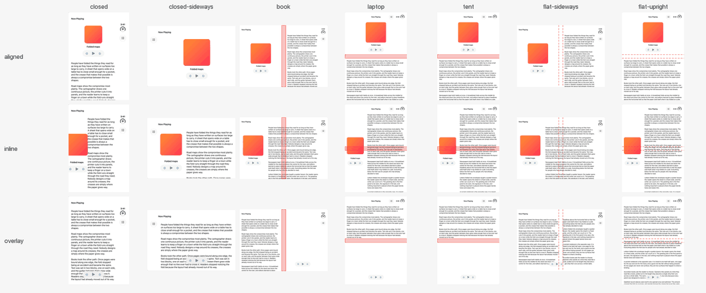

<!-- Generated by scripts/sync-skill-references.py from patterns/arrangement.md. Edit the source, then rerun it. -->

# Arrangement

> A primary view and the view that supports it (a player and its transcript, an article and its contents), laid out by the system's `ArrangementView`: side by side or one above the other by the window's shape, a split with its boundary on the fold, where it already is when the phone is open flat.

**Change**: local when `Arrangement` takes the place of the app's stack of the two views only where the window has a
vertical bar or a reserved region, the app's own stack kept elsewhere; structural when `ArrangementView` runs with no
gate (it lays the views out by the window's shape on every iOS 27.1 device) or a view the app presents (a sheet, an
overlay) moves into the arrangement. The reference file is not gated as written: on iOS 27.1 it is `ArrangementView` in
every window. Gate it where you use it: `Arrangement` where a `GeometryReader`'s `reservedRegions(kind: .division,
options: .includeInactive)` is not empty or `toolbarVerticalEdge` is not nil (every Duo pose has one or the other), the
app's own stack elsewhere. The two are different views, so keep their state (a selection, a scroll position, a player)
in the caller. The decision table's "Local and structural changes" says why.

**Pose matrix**: generated by [`Examples/Catalog`](https://github.com/3nchiridion/foldsmith/tree/main/Examples/Catalog) with [`scripts/capture-catalog.sh`](https://github.com/3nchiridion/foldsmith/blob/main/scripts/capture-catalog.sh), never hand-made. Rows: the
reference as a split (`aligned`: a player and its transcript, Podcasts' shape), the reference as an overlay (`overlay`:
the player's controls over the text, Accessibility Reader's shape) and the "before" variant (`inline`: the player in a
fixed third of the width beside the transcript, in an `HStack`, the shape of Wikipedia's inline contents). The red
band is the active division; a dashed outline is the inactive one.

Citations: `[tt-<id> m:ss]` is an Apple tech talk at that chapter (notes in [`raw/apple-docs/`](https://github.com/3nchiridion/foldsmith-evidence/tree/main/raw/apple-docs/)), `[hig …]` the HIG
article, `[apple-apps/<app>/<pose>]` a screenshot in [`raw/apple-apps/`](https://github.com/3nchiridion/foldsmith-evidence/tree/main/raw/apple-apps/), `[metrics:<pose>]` [`raw/metrics.json`](https://github.com/3nchiridion/foldsmith-evidence/blob/main/raw/metrics.json);
T-codes are the defect classes in [`patterns/TAXONOMY.md`](https://github.com/3nchiridion/foldsmith/blob/main/patterns/TAXONOMY.md), P-numbers the patterns in [`patterns/DECISION-TABLE.md`](https://github.com/3nchiridion/foldsmith/blob/main/patterns/DECISION-TABLE.md),
and G1–G6 the gates in [`EVAL.md`](https://github.com/3nchiridion/foldsmith/blob/main/EVAL.md).

## Context
Supporting content: a secondary view that means something only next to its primary (a transcript, a queue, an
inspector, a table of contents). Decision table rows `supporting / viewing`, `supporting / editing` and `supporting /
controlling`. Corpus: Wikipedia's table of contents, an inline sidebar of 0–318 pt beside the article on the inner
display, whose article pane runs across the fold in book ([`verification/runs/Wikipedia/audit.md`](https://github.com/3nchiridion/foldsmith-evidence/blob/main/verification/runs/Wikipedia/audit.md), `contents`).
Apple: Podcasts sets its Now Playing screen beside its transcript as a split, and Accessibility Reader floats its
controls over the text as an overlay [tt-111463 9:20, 14:39].

## Forces
- Two views kept side by side by an `HStack` keep their boundary where the app put it. In book the wider view crosses
  the fold, and a view centred in a full-height pane upright (artwork, a player) lands on the horizontal fold.
- The window changes shape with the pose: wider than tall on the turned cover, in book and flat sideways; taller than
  wide on the cover and upright. One axis cannot suit every pose, and a layout per pose is what the HIG asks apps not
  to build [hig anatomy].
- On the cover there is room for one view well or two views badly; the secondary still has to stay reachable.
- An overlay hides part of what is beneath it. That suits controls over a scrolling text, never two views that must
  both be read.
- A layout rebuilt on each fold loses the views' state; one container kept across the fold keeps it (whether it
  animates was not observed).
- Open flat sideways, the system's split halves the window, so the trailing view runs across the inactive fold and
  folding then moves the boundary; the inner display's other patterns lay out the flat phone as if it were folded.

## Solution
Measured in the catalog ([`verification/matrices/arrangement/`](https://github.com/3nchiridion/foldsmith-evidence/tree/main/verification/matrices/arrangement/), window points; the vertical bar is the trailing or
leading 84 pt band).

| Pose | Split (`aligned`) | Overlay (`overlay`) | Source |
|---|---|---|---|
| closed | one above the other: primary y 82–363, secondary 363–644 (**differs from the decision table**, which asks for the primary alone) | the secondary fills 0–382, the primary at its foot | [tt-111463 12:00; hig arrangement views] |
| closed-sideways | one view: the primary alone, 84–678 (the system shows one view where it cannot split on the window's axis [tt-111463 12:00]; which input decided was not measured; the frame record keeps the hidden secondary at the primary's frame, while the shot and the accessibility capture show the primary alone) | the secondary fills 84–678, the primary at its foot | [tt-111463 12:00] |
| book | side by side: primary 0–455.5, secondary 495.5–867.2; the boundary is the division | side by side: secondary 0–455.7, the primary (controls 597.2–765.2) centred on the trailing half, at its foot | [hig alt text split arrangement; hig arrangement views; overview] |
| laptop, tent | one above the other: primary y 82–455.5 on the top half, secondary 495.5–917 on the bottom half | secondary y 82–455.5, primary on the bottom half, at its foot | split [tt-111463 12:00]; overlay [overview; tt-111463 4:00] |
| flat-sideways | as book: primary 0–455.5, secondary 495.5–867.2, the boundary told where the inactive division is | the secondary fills 0–867, the primary centred at its foot (controls 349.5–517.5, across the inactive division) | [hig arrangement views; tt-111463 7:50] |
| flat-upright | as laptop: primary y 82–455.5, secondary 495.5–917 (**differs from Podcasts' upright frame**, [`verification/oracle/arrangement.md`](https://github.com/3nchiridion/foldsmith-evidence/blob/main/verification/oracle/arrangement.md)) | the secondary fills, the primary at its foot | [tt-111463 12:00; tt-111463 7:50] |

The rule: put the two views in one `ArrangementView` and let the system place them. Use `.split` when neither view
may cover the other (a transcript, a queue you read) and `.overlay` when the primary is a foreground over scrollable
content (controls over a text) [tt-111463 14:39]; an `HStack` or `VStack` becomes a split, a `ZStack` an overlay
[hig arrangement views]. Keep the navigation container outside the arrangement, and never put the arrangement inside
a `List` or `ScrollView` [tt-111463 16:09]. Set no axis: the system splits by the window's shape and puts the boundary
on an active fold. While the fold is inactive (open flat), tell a split where it is: the primary's share ends at the
division's near edge (`splitArrangementLayoutRatio`) and the secondary's content starts at its far edge, so the views
sit where folding will put them [tt-111463 7:50]. In a split, the primary is the view that matters on its own: leading
or on top, and the one shown where only one fits. In an overlay, the primary is the foreground drawn over the
secondary (controls, a queue); when folded it goes trailing or to the bottom half, the secondary leading or to the top
half [overview].

## Consequences
- On the cover a split shows both views, 281 pt each, where the decision table asks for the primary alone [hig
  arrangement views; tt-111463 13:21]. The reference keeps the system's split. The collapse those sources describe is
  the overlay's (`overlayArrangementZIndex` [tt-111463 14:07]); hiding a split's secondary on the cover, by a ratio or
  by the app's own state, was not tried.
- Flat, the split reference leaves the 40 pt of the inactive division empty, at the secondary's leading or top edge,
  where the system's own split halved the window sideways (0–433.5 and 433.5–867.2, measured before this rule, not
  committed); that split's text ran across the inactive division (T5, seen by the accessibility detectors), and on
  folding its boundary moved 22 pt (433.5 to 455.5) and its text about 62 pt (453.5 to 515.7). The upright pose was
  not measured before the rule. The ratio is the system's input, not a frame: where the system cannot honour it, its
  own split wins. The overlay takes no ratio: flat sideways its controls stay centred across the inactive division
  (349.5–517.5), as Accessibility Reader's do ([`verification/oracle/arrangement.md`](https://github.com/3nchiridion/foldsmith-evidence/blob/main/verification/oracle/arrangement.md)), and move to the trailing half
  on folding (597.2–765.2).
- In laptop and tent the split puts a player's controls on the top half, where the talk puts media controls on the
  bottom one [tt-111463 4:00]; a primary that is mostly controls fits the overlay better, which puts them there.
- A folded overlay gives its primary a whole half. Controls alone leave that half mostly empty (the catalog's laptop
  pose): an overlay suits a primary with something to show in a half, as Podcasts' queue beside its player
  [tt-111463 13:21; frame 14:10, [`verification/oracle/arrangement.md`](https://github.com/3nchiridion/foldsmith-evidence/blob/main/verification/oracle/arrangement.md), which draws no crease, so whether that phone is
  folded is not shown].
- The turned cover shows the primary alone in a split, so whatever the secondary holds must be reachable from the
  primary there (a button that presents it). Neither the reference nor the catalog does this: the catalog's Queue
  button does nothing, so its transcript cannot be reached on the turned cover. Untested signals that the secondary
  is hidden: UIKit `state(for: .secondary)?.isHidden`, SwiftUI `splitArrangementAxis`.
- The catalog's overlay sets its text in `ReflowingColumns` (P2): two columns flat sideways, one in its half when
  folded. A secondary is a layout of its own and follows its own pattern.

## Known uses
- Apple: Podcasts' Now Playing beside its transcript (split) and Accessibility Reader's controls over its text
  (overlay), shown in the talk *Strike a pose with adaptive layouts on iPhone Duo* [tt-111463 9:20, 14:39]; not on
  the 27.1 simulator. G4 sets the reference beside those frames ([`verification/oracle/arrangement.md`](https://github.com/3nchiridion/foldsmith-evidence/blob/main/verification/oracle/arrangement.md)): flat sideways
  and in book, the same assignment as Podcasts (player leading, transcript trailing, clear of the division), with
  different bars; upright it differs, since Podcasts shows one screen with its transcript above its controls and its
  bar at the foot, where the reference stacks the whole player above the transcript; the overlay has Accessibility
  Reader's assignment flat sideways; no frame of either app was found on the cover or in tent.
- Corpus before: Wikipedia's table of contents, book: an inline sidebar of 0–318 pt and the article pane across the
  fold (T14), with the "W" on it (T1) ([`verification/runs/Wikipedia/audit.md`](https://github.com/3nchiridion/foldsmith-evidence/blob/main/verification/runs/Wikipedia/audit.md); the shot is in the run's working
  copy, not in git). The catalog's `inline` variant reproduces the shape: its transcript's text spans 309–847 pt in
  book, and the artwork, centred in its full-height pane, lies across the fold in laptop and tent. Wikipedia shows
  the contents as a modal at compact width and inline at regular width, and recreates their view controller each
  time the horizontal size class changes between the two, which on the Duo is between the cover and the inner display
  (`ArticleTableOfContentsDisplayController`, in wikipedia-ios at 2031b89).

## When not to use it
- A list whose items open into a detail: hierarchical, **Fold-aligned split**. An arrangement does not navigate.
- One text read in order: continuous, **Reflowing columns**.
- Items of equal standing: peer, **Even grid**.
- A map: it pans, so it stays whole; only what sits on it moves off the fold (the decision table's map rule).
- Two views where the secondary is only sometimes needed and covers the primary while it is (a settings sheet, an
  editor): a sheet. The system moves it off the fold [tt-111466 8:36] but onto the leading half in book (T15); place
  it trailing while the division is active (**Fold-aligned split**'s sheet rule).

## Reference implementation
[`Sources/Patterns/Arrangement.swift`](Arrangement.swift): one file, copy-in, no dependency on
this repository. `Arrangement(.split) { Player() } secondary: { Transcript() }`, or `.overlay` with the primary drawn
at the foot of its region. On iOS 27.1 it is one `ArrangementView` for every pose; before 27.1, and on Mac Catalyst,
visionOS and macOS, it is the layout an app had: an `HStack` or `VStack` by shape for a split (one `AnyLayout`, so the
views keep their state across a change of shape), a `ZStack` for an overlay.

UIKit: `UIArrangementViewController` inside the `UINavigationController`, with `setViewController(_:for:)` for
`.primary` and `.secondary` and `updateArrangement(.split)` or `.overlay` [tt-111463 11:17, 13:07]. Open flat, do what
the SwiftUI reference does: read `view.reservedRegions(kind: .division, options: .includeInactive)`, give the primary a
fractional width or height ending at the inactive division's near edge through `UISplitArrangement.ViewProperties`
and `setViewProperties(_:for: .primary)`, pass that arrangement to `updateArrangement`, and inset the secondary's
content by the division's width; a ratio is the system's input, not a frame. Not measured in the catalog.

## Detectors this pattern must pass
T1 (crease-straddle, for the primary's artwork and controls), T5 (stretched-single-column, for the secondary's text),
T14 (columns-off-fold: side by side in book, and `PanesOffHorizontalFold` for views one above the other in laptop and
tent). The split's two views are recorded as panes, the overlay's secondary as a pane and its controls as a control
(so for the overlay only T1 on the controls checks the primary); the `inline` variant records only what accessibility
reads, its leaves and its text. Run on every capture by `swift test` ([`Tests/DuoPoseTestingTests/MatrixTests.swift`](https://github.com/3nchiridion/foldsmith/blob/main/Tests/DuoPoseTestingTests/MatrixTests.swift));
the `inline` variant must show T5 in book and flat sideways, T1 in laptop and tent, and nothing else.

Result on the committed captures (`swift run duo-detect Tests/Fixtures/matrices`; · = no finding):

| config | closed | closed-sideways | book | laptop | tent | flat-sideways | flat-upright |
|---|---|---|---|---|---|---|---|
| arrangement/aligned | · | · | · | · | · | · | · |
| arrangement/inline | · | · | T5 | T1 | T1 | T5 | · |
| arrangement/overlay | · | · | · | · | · | · | · |
