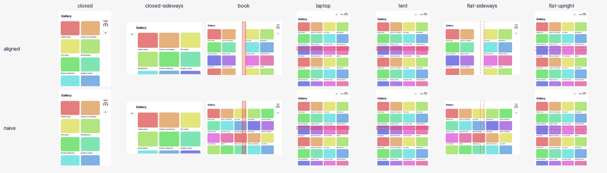

<!-- Generated by scripts/sync-skill-references.py from patterns/even-grid.md. Edit the source, then rerun it. -->

# Even grid

> A scrolling grid of peer items that keeps an even column count on the inner display and puts the fold in the gutter, so no column straddles it.

**Pose matrix**: generated by [`Examples/Catalog`](https://github.com/3nchiridion/foldsmith/tree/main/Examples/Catalog) with [`scripts/capture-catalog.sh`](https://github.com/3nchiridion/foldsmith/blob/main/scripts/capture-catalog.sh), never hand-made. Rows: the
reference (`aligned`) and the "before" variant (`naive`, an adaptive grid centred in the safe area). The red band is
the active division; a dashed outline is the inactive one.

Citations: `[tt-<id> m:ss]` is an Apple tech talk at that chapter (notes in [`raw/apple-docs/`](https://github.com/3nchiridion/foldsmith-evidence/tree/main/raw/apple-docs/)), `[hig …]` the HIG
article, `[apple-apps/<app>/<pose>]` a screenshot in [`raw/apple-apps/`](https://github.com/3nchiridion/foldsmith-evidence/tree/main/raw/apple-apps/), `[metrics:<pose>]` [`raw/metrics.json`](https://github.com/3nchiridion/foldsmith-evidence/blob/main/raw/metrics.json);
T-codes are the defect classes in [`patterns/TAXONOMY.md`](https://github.com/3nchiridion/foldsmith/blob/main/patterns/TAXONOMY.md), P-numbers the patterns in [`patterns/DECISION-TABLE.md`](https://github.com/3nchiridion/foldsmith/blob/main/patterns/DECISION-TABLE.md),
and G1–G6 the gates in [`EVAL.md`](https://github.com/3nchiridion/foldsmith/blob/main/EVAL.md).

## Context
Peer content: items of equal standing, browsed or controlled one at a time. Decision table rows `peer / viewing`
(feeds, galleries, photo grids) and `peer / controlling` (dashboard tiles). Corpus: Wikipedia's Explore feed, whose
trailing column starts at 458.7 pt, inside the fold [[raw/corpus/defects.csv](https://github.com/3nchiridion/foldsmith-evidence/blob/main/raw/corpus/defects.csv), T14]. Apple: Fitness's grid keeps its
outer margins and widens the spacing at the hinge [tt-111463 5:12].

## Forces
- An adaptive grid fills the width with as many columns as fit; on the 867 pt book window that is five, and the middle
  one lands on the fold.
- Centring the grid in the safe area does not centre it on the fold: the vertical bar makes the safe area asymmetric
  (trailing 84 pt), so the window's middle (433.5 pt) is 42 pt left of the crease's centre (475.5 pt).
- Equal columns read as a grid; but the two halves of the book window are not equal (439.5 pt and 355.5 pt of content
  width after margins), so equal halves are impossible without giving something up.
- A grid that changes its column count on every fold makes the user hunt for the item they were looking at
  [hig reserved regions: avoid extreme layout changes].

## Solution

| Pose | Columns | Where the fold goes | Source |
|---|---|---|---|
| closed | 2, flexible (16–185, 197–366 pt) | no division | [metrics:closed; hig best practices 1] |
| closed-sideways | 3, flexible | no division | [metrics:closed-sideways] |
| book | 4, 171.75 pt each: 2 per half (16–187.8, 199.8–371.5 · 495.5–667.2, 679.2–851) | in the gutter: 371.5–495.5 pt, the division plus the spare width of the wider half | [hig reserved regions; tt-111463 5:12; metrics:book] |
| laptop, tent | 4, flexible (16–653 pt) | scrolls across the horizontal fold | [tt-111466 9:28; tt-111463 2:26] |
| flat-sideways | as book: 4 × 171.75 pt, 2 per half | in the gutter: the inactive division still sets the count, so folding to book moves nothing | [tt-111463 7:50] |
| flat-upright | 4, flexible (16–653 pt), as laptop | inactive and horizontal: scrolls across | [tt-111463 7:50; tt-111466 9:28] |

The rule: wherever the window has a vertical division, active or inactive, each half gets the same number of columns
of the same width, set by the narrower half; the outer margins stay 16 pt and the spare width goes into the gutter at
the hinge. Rows line up across the fold because every column is the same width. Fitness keeps its margins and widens
the spacing at the hinge too [tt-111463 5:12], but only to the division: its frames show its leading columns wider
than its trailing ones ([`verification/oracle/even-grid.md`](https://github.com/3nchiridion/foldsmith-evidence/blob/main/verification/oracle/even-grid.md)). With no vertical division it is an ordinary grid, rounded
down to an even count once the window is 600 pt or wider.

## Consequences
- The book gutter is wide: 124 pt, three times the division. The alternative, columns of different widths per half,
  keeps a 40 pt gutter but makes the trailing tiles shorter, so rows no longer line up (seen in the catalog before
  this rule; trailing tiles sat lower than leading ones). Fitness takes that alternative without that cost: its
  cards' heights do not follow their widths, so its rows still line up across the fold
  ([`verification/oracle/even-grid.md`](https://github.com/3nchiridion/foldsmith-evidence/blob/main/verification/oracle/even-grid.md)).
- Four columns where five fit: about 20 % less density in book than the naive grid.
- The narrower half decides: a minimum cell width above 171.75 pt leaves one column per half in book; 110.5 pt or less
  gives three per half.
- Cells get narrower than in the naive grid, so text that a cell cuts off shows less: Wikipedia's tab cards went from
  207 × 276 to 177 × 236 pt, its Explore columns from 418 to 366 pt. A cell whose height was worked out for the old
  width must be laid out again for the new one (Wikipedia's "In the news" footer ran 7 pt out of its cell until it was).
- Laptop and tent keep a grid scrolling straight across the fold. That is Apple's prescription for scrolling content,
  not a gap; a fixed control over the grid must still avoid the fold (T1).

## Known uses
- Apple: Fitness, as described in [tt-111463 5:12] and shown in that talk's frames; not on the 27.1 simulator. G4 sets
  the reference beside those frames ([`verification/oracle/even-grid.md`](https://github.com/3nchiridion/foldsmith-evidence/blob/main/verification/oracle/even-grid.md)): in book the same count, two columns a side,
  and the same bar placement, but Fitness widens its leading columns (about 212 pt against 171) where the reference
  widens the gutter, and the bar items differ; open flat, Fitness spaces its four columns evenly where the reference
  keeps its book layout.
- Corpus before: Wikipedia Explore, book, a card column starting at 458.7 pt
  ([`raw/corpus/evidence/Wikipedia/explore-book-inner.png`](https://github.com/3nchiridion/foldsmith-evidence/blob/main/raw/corpus/evidence/Wikipedia/explore-book-inner.png)). The catalog's `naive` variant reproduces the shape: its
  middle column spans 354.8–512.2 pt.
- Corpus after: Wikipedia's Explore (Community), a UIKit collection view, one column per half, and its tabs grid, a
  SwiftUI grid, two per half; every column as wide as the narrower half allows, the spare width in the gutter: verified
  in all seven poses by the skill ([`verification/runs/Wikipedia/`](https://github.com/3nchiridion/foldsmith-evidence/tree/main/verification/runs/Wikipedia/)).

## When not to use it
- Uniform rows that each stand for a page a tap opens (a timeline of posts, a list of articles, search results):
  hierarchical content, use **Fold-aligned split**. A chat transcript, read in order with nothing to open, is continuous: **Reflowing
  columns** or one scrolling column. The decision table's I1 says which a feed is.
- One item with its supporting detail (a photo and its metadata): [**Arrangement**](arrangement.md) (P4).
- Two or three large tiles that must not shrink: one per half is still this pattern with a high minimum width; more
  than one per half at that size is not possible in book.

## Reference implementation
[`Sources/Patterns/EvenGrid.swift`](EvenGrid.swift): one file, copy-in, no dependency on this
repository. `EvenGrid(items, minCellWidth: 150) { item in Cell(item) }`. The fold query is gated with
`#available(iOS 27.1, *)`; before 27.1 it is the plain grid. Uses `reservedRegions(kind: .division, options:
.includeInactive)` so the count does not change when the phone goes from flat to book.

## Detectors this pattern must pass
T1 (crease-straddle, for any fixed control over the grid), T14 (columns-off-fold). Run on every capture by
`swift test` ([`Tests/DuoPoseTestingTests/MatrixTests.swift`](https://github.com/3nchiridion/foldsmith/blob/main/Tests/DuoPoseTestingTests/MatrixTests.swift)); the `naive` variant must show T14 in book and nothing
else.

Result on the committed captures (`swift run duo-detect Tests/Fixtures/matrices`; · = no finding):

| config | closed | closed-sideways | book | laptop | tent | flat-sideways | flat-upright |
|---|---|---|---|---|---|---|---|
| grid/aligned | · | · | · | · | · | · | · |
| grid/naive | · | · | T14 | · | · | · | · |
