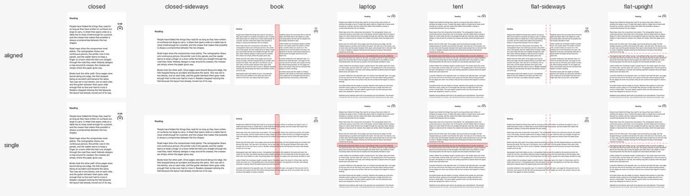

<!-- Generated by scripts/sync-skill-references.py from patterns/reflowing-columns.md. Edit the source, then rerun it. -->

# Reflowing columns

> Continuous reading content that becomes two columns, one on each side of the fold, whenever the inner display is held sideways, and stays one scrolling column everywhere else.

**Pose matrix**: generated by [`Examples/Catalog`](https://github.com/3nchiridion/foldsmith/tree/main/Examples/Catalog) with [`scripts/capture-catalog.sh`](https://github.com/3nchiridion/foldsmith/blob/main/scripts/capture-catalog.sh), never hand-made. Rows: the
reference (`aligned`) and the "before" variant (`single`, one scrolling column across the window). The red band is
the active division; a dashed outline is the inactive one.

Citations: `[tt-<id> m:ss]` is an Apple tech talk at that chapter (notes in [`raw/apple-docs/`](https://github.com/3nchiridion/foldsmith-evidence/tree/main/raw/apple-docs/)), `[hig …]` the HIG
article, `[apple-apps/<app>/<pose>]` a screenshot in [`raw/apple-apps/`](https://github.com/3nchiridion/foldsmith-evidence/tree/main/raw/apple-apps/), `[metrics:<pose>]` [`raw/metrics.json`](https://github.com/3nchiridion/foldsmith-evidence/blob/main/raw/metrics.json);
T-codes are the defect classes in [`patterns/TAXONOMY.md`](https://github.com/3nchiridion/foldsmith/blob/main/patterns/TAXONOMY.md), P-numbers the patterns in [`patterns/DECISION-TABLE.md`](https://github.com/3nchiridion/foldsmith/blob/main/patterns/DECISION-TABLE.md),
and G1–G6 the gates in [`EVAL.md`](https://github.com/3nchiridion/foldsmith/blob/main/EVAL.md).

## Context
Continuous content read in order: articles, documents, long notes. Decision table row `continuous / viewing`.
Corpus: Wikipedia's article in book, one column whose every line crosses the fold (measure 686–743 pt)
[[raw/corpus/defects.csv](https://github.com/3nchiridion/foldsmith-evidence/blob/main/raw/corpus/defects.csv), T5]. Apple: two-column layouts that reflow from one are how the inner display uses its
width [tt-111466 7:34]; Safari scrolls one column straight across the laptop fold [apple-apps/safari/laptop].

## Forces
- A line measure of 700 pt or more is hard to read anywhere, and in book every line also crosses the spine
  [tt-111463 1:29].
- Continuously scrolling content must not displace [tt-111463 2:26], so the text cannot simply be pushed to one half.
- Two columns that each scroll on their own break the reading order: the reader has to scroll up again to start the
  second column.
- The horizontal fold (laptop, tent) is the opposite case: one column scrolls across it, and Apple exempts scrolling
  content from fold avoidance [tt-111466 9:28].

## Solution

| Pose | Layout | Columns (window pt) | Source |
|---|---|---|---|
| closed | one column, scrolls | 20–362 | [hig best practices 2; tt-111463 2:26] |
| closed-sideways | one column, scrolls | 104–658 | [metrics:closed-sideways] |
| book | two columns per page, pages sideways; the division is the gutter | 20–455.5 and 495.5–847 | [tt-111466 7:34; hig reserved regions; metrics:book] |
| laptop, tent | one column, scrolls across the fold | 20–649 | [tt-111466 9:28; tt-111463 2:26; apple-apps/safari/laptop] |
| flat-sideways | as book: two columns per page, paged; the inactive division is the gutter, so folding to book moves nothing | 20–455.5 and 495.5–847 | [tt-111466 7:34; tt-111463 7:50] |
| flat-upright | one column, scrolls | 20–649 | [apple-apps/safari/flat-upright] |

The rule: when the window is wider than tall and has a vertical division, active or inactive, lay the text into a
chain of column-sized containers, the leading one ending at the division's leading edge and the trailing one starting
at its trailing edge, two per page, and page sideways one spread at a time, like a book. Otherwise one column that
scrolls. The inactive division counts so the layout does not change when a flat phone is folded to book
[tt-111463 7:50].

## Consequences
- Paging replaces scrolling on the sideways inner display. Readers who expect to scroll get a swipe instead; the
  spread is the unit, as in Books.
- The two columns differ: 435.5 pt and 351.5 pt of measure in book, because the vertical bar takes 84 pt on the
  trailing edge. Equal columns would waste 84 pt on the leading side; the text reads fine at both widths.
- TextKit 1 (`NSLayoutManager` with one `NSTextContainer` per column) carries the text across columns; SwiftUI's `Text`
  cannot. That brings UIKit into the file, and text selection does not run across columns.
- Inline images, tables and code blocks need their own rule (keep each whole inside one column); the reference handles
  plain paragraphs only.

## Known uses
- Apple: the tech talk describes the shape [tt-111466 7:34] and shows it with Music's album page, two blocks side by
  side, not a text. Books and Notes are not on the 27.1 simulator; no frame of Books was found, and the sources
  collected in [`raw/apple-docs/`](https://github.com/3nchiridion/foldsmith-evidence/tree/main/raw/apple-docs/) describe Notes as a split view (the HIG) and as an app whose toolbar moves into the
  vertical bar (111462), never as a text in columns. No Apple frame looked at shows a text in columns, so G4 stays
  open ([`verification/oracle/reflowing-columns.md`](https://github.com/3nchiridion/foldsmith-evidence/blob/main/verification/oracle/reflowing-columns.md)). Safari's one column across the laptop fold
  [apple-apps/safari/laptop] is the upright half of this pattern, as context, not as the oracle.
- Corpus before: Wikipedia's article, book ([`raw/corpus/evidence/Wikipedia/article-book-inner.png`](https://github.com/3nchiridion/foldsmith-evidence/blob/main/raw/corpus/evidence/Wikipedia/article-book-inner.png)). The catalog's
  `single` variant reproduces it: one column 0–867 pt across the fold.

## When not to use it
- Content the user edits: the decision table has no cited cell for editing continuous content across a vertical fold
  (`UNJUSTIFIED`), so keep one column and stop at the audit.
- Lists of separate items: uniform rows that each open a page (a timeline, a list of articles, search results) are
  hierarchical (**Fold-aligned split**); cards complete where they stand, browsed in any order, are peer (**Even
  grid**). The decision table's I1 says which a feed is.
- A map: it pans, so it stays whole; only what sits on it moves off the fold (the decision table's map rule).
- An article that is mostly media: [**Arrangement**](arrangement.md) (P4) with the media primary and the text secondary.

## When the text is a web page
The reference lays out paragraphs with TextKit. Most apps that read articles draw them in a `WKWebView` (Wikipedia
[[verification/runs/Wikipedia](https://github.com/3nchiridion/foldsmith-evidence/tree/main/verification/runs/Wikipedia)]), and the app's own features usually address the page by its vertical offset: Wikipedia's
contents jumps, find in page, scroll restoration and its native lead image all do. Paged CSS columns would give this
pattern's shape but break those, so the run did not build them (not measured here). What it did, and what holds:
- Where the article is opened from a list, open it in the detail pane of a **Fold-aligned split**: the pane ends at
  the vertical bar and starts after the fold, so one column fits it (Wikipedia from Saved, History and Search).
- Move the article's bars into the vertical bar: symbols with a title, or custom views set to `.verticalPreferred`
  (T10; a custom-view toolbar can vanish in book, T7). Choose with `visibilityPriority` which actions stay in the bar
  when it is short (the cover, turned) and check the rest in its overflow.
- Check the page at the pane's width with everything the article shows beside its text: Wikipedia's inline contents
  left the text clipped at the edge of the 372 pt pane, a regression the review caught; in that pane the contents now
  open as the app's overlay and the article keeps the whole pane (Fold-aligned split, "UIKit without a split view").
- Where the article opens full-screen with no list (Wikipedia from Home or Places) it still crosses the fold: T5,
  left in `todo` until columns can keep those features.

## Reference implementation
[`Sources/Patterns/ReflowingColumns.swift`](ReflowingColumns.swift): one file, copy-in, no
dependency on this repository. `ReflowingColumns(paragraphs: article.paragraphs)`. The fold query is gated with
`#available(iOS 27.1, *)`; before 27.1 it is the single scrolling column.

## Detectors this pattern must pass
T5 (stretched-single-column), T14 (columns-off-fold), T1 (crease-straddle) for any fixed control over the text. Run
on every capture by `swift test`; the `single` variant must show T5 in book and flat-sideways and nothing else.

Result on the committed captures (`swift run duo-detect Tests/Fixtures/matrices`; · = no finding):

| config | closed | closed-sideways | book | laptop | tent | flat-sideways | flat-upright |
|---|---|---|---|---|---|---|---|
| columns/aligned | · | · | · | · | · | · | · |
| columns/single | · | · | T5 | · | · | T5 | · |
