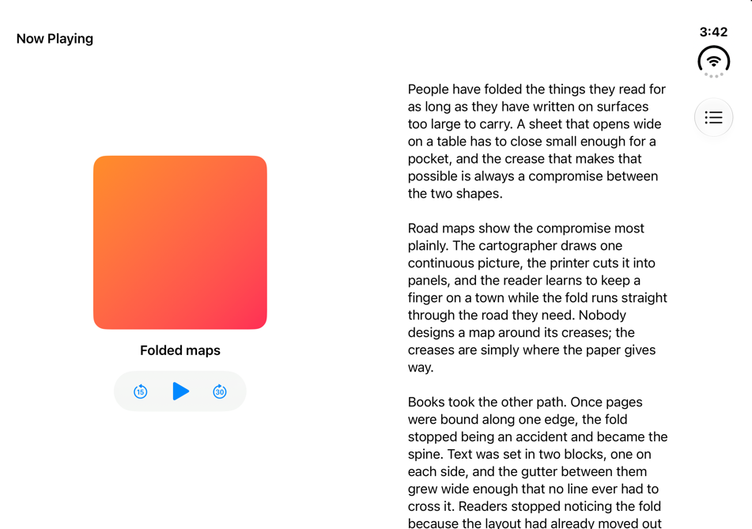
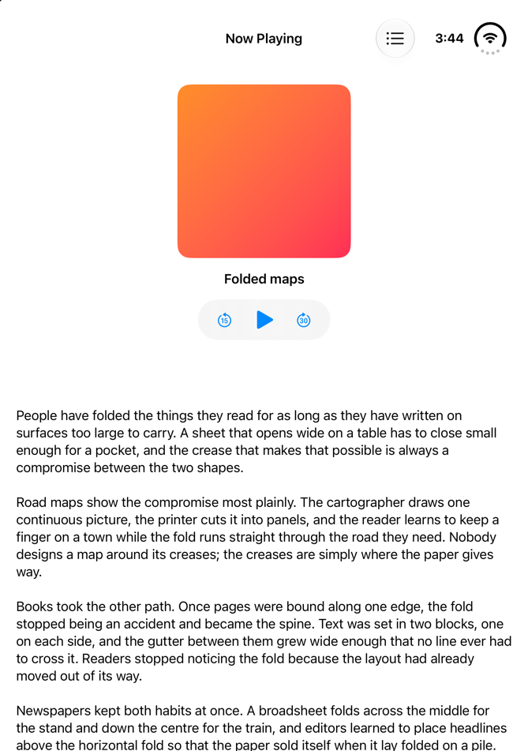
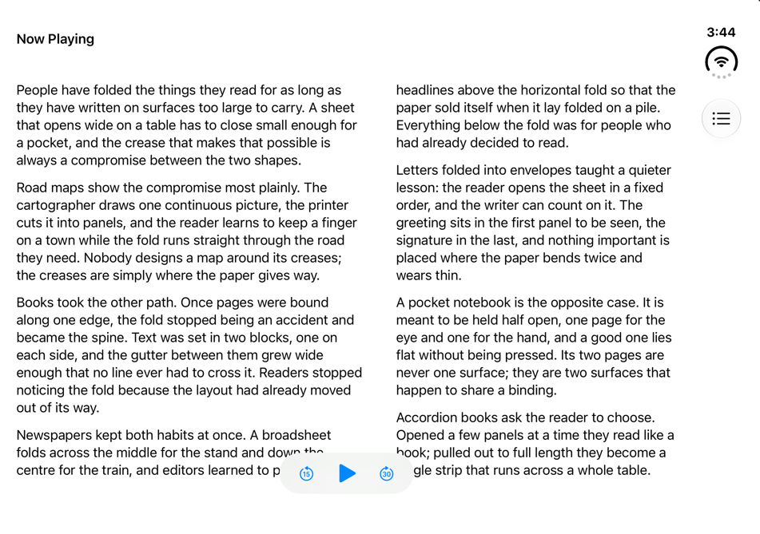
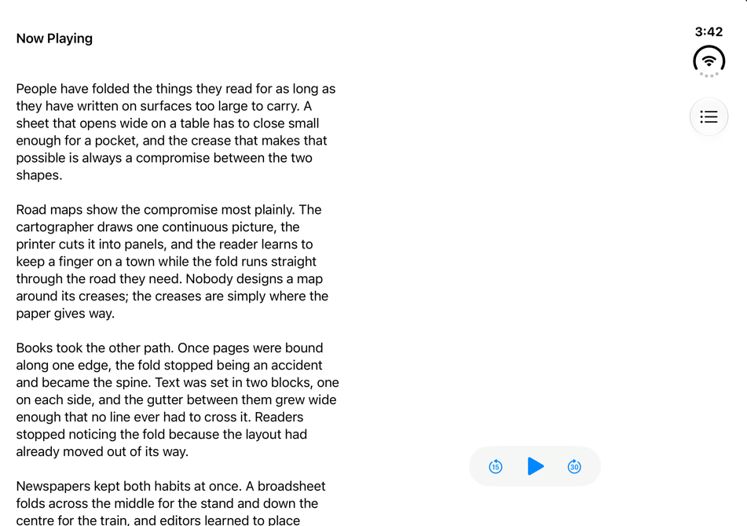

# G4 — Arrangement against Podcasts and Accessibility Reader

EVAL.md G4: *for each pattern, the matched system app in the same pose shows the same pane assignment and bar
placement*. Arrangement's matches are the two apps Apple uses to explain arrangements: Podcasts, whose Now Playing
view sits beside its transcript as a split, and Accessibility Reader, whose controls float over its text as an
overlay [tt-111463 9:20, 14:39]. Neither is on the iOS 27.1 simulator, so under G4 as amended on 2026-10-29 (EVAL.md
§1, `docs/history/DEVIATIONS.md`) the reference is set beside Apple's own published frames of them.

- **Apple**: the tech talk *Strike a pose with adaptive layouts on iPhone Duo* (111463) shows:
  - Podcasts with its transcript on the inner display open flat, held sideways and face-on
    ([9:53](https://developer.apple.com/videos/play/tech-talks/111463/?time=593));
  - the same folded like a book, at an angle
    ([9:58–10:01](https://developer.apple.com/videos/play/tech-talks/111463/?time=598)), then the Now Playing view
    alone, folded, its artwork across the crease (10:05–10:19);
  - Podcasts' transcript on the inner display held upright, face-on
    ([10:26–10:30](https://developer.apple.com/videos/play/tech-talks/111463/?time=628));
  - Podcasts' queue beside a small player, face-on, no crease drawn (14:10), the overlay the talk's code builds there;
  - Accessibility Reader on the inner display open flat, held sideways and face-on, its page labelled Background and
    its controls Foreground ([15:10–15:22](https://developer.apple.com/videos/play/tech-talks/111463/?time=915)).

  The frames are not stored here: they are Apple's, as the talks' transcripts are (`docs/history/DEVIATIONS.md`, 2026-10-24). The
  links open the video at the frame.
- **The reference**: `Arrangement` (`Sources/Patterns/Arrangement.swift`), as a split (`aligned`) and as an overlay
  (`overlay`), captured in `verification/matrices/arrangement/` at 1 px per point, each shot with the catalog's own
  record of its frames.
- **How it was measured**: the face-on frames were read from the talk's 1920 × 1080 rendition, in its video pixels. A
  dark gap of 2–3 px separates the display from the bezel on all four sides; it encloses 1120 × 788 px, so the scale is
  1.178 px per point for the 951 × 669 pt display, the same across and down. Figures from those frames are good to
  about ±2 pt. The folded frames are at an angle, so they give which view sits on which side of the crease, not
  positions in points. The upright and 14:10 frames were read for their layout, not measured.

## Result
| Pose | Apple | The reference | Verdict |
|---|---|---|---|
| flat-sideways, split | Podcasts: the player leading (its scrubber 53.5–449.9 pt, its volume slider 78.1–415.1, its art ending about 451), the transcript trailing, its text from about 503 pt: both clear of the inactive division (455.5–495.5). The status at the top of the trailing strip; the transcript and queue buttons side by side at the foot of the transcript (about 752–787 and 837–860 pt), not in the strip | the player in 0–455.5 (its artwork 117.8–337.8), the transcript in 495.5–867.2, its text from 515.7 pt. The status and the queue button at the top of the trailing bar | **same assignment; the bars differ**: player leading, transcript trailing, nothing on the inactive division; the status sits at the top of the trailing strip in both, but Podcasts puts its transcript and queue buttons in a row at the foot of the transcript, where the reference puts its queue button in the trailing bar at the top. Podcasts' transcript text starts about 12 pt nearer the division (about 503 against 515.7 pt), and it centres its player about 20 pt further right (its controls about 247–252 pt against 227.8) |
| book, split | Podcasts: the player on the leading half, the transcript on the trailing half, the crease between them; the transcript and queue buttons in a row at the foot of the trailing half (angled frames, not measured). At 10:05–10:19, the Now Playing view alone, its artwork across the crease | primary 0–455.5, secondary 495.5–867.2; the status and the queue button at the top of the trailing bar | **same assignment; the bars differ as flat**. The reference has no single-view state in book and keeps its artwork off the fold (T1) |
| flat-upright, split | Podcasts: one screen with no split: a header (art thumbnail and title) at the top, the transcript, then the scrubber, the controls and a bar (transcript, AirPlay, queue) at the foot | two views one above the other: the player y 82–455.5, the transcript 495.5–917; its title and queue button at the top | **differs**: Podcasts shows its transcript above the player's controls at the foot, nearer the reference's overlay than its split (whether the text runs beneath the controls cannot be told from the frame), where the reference's split stacks the whole player above the transcript; its bar is at the foot, the reference's at the top |
| flat-sideways, overlay | Accessibility Reader: its page (labelled Background) fills the display; the text on it is one column about 136–722 pt; the controls float at the foot in a card about 206–663 pt, centred at about 434.5. An item at the top leading corner and a search field across the top, the status at the trailing top (whole frame, not measured) | the text fills 0–867 in two columns (20–455.5 and 495.5–847, Reflowing columns); the controls float at the foot, 349.5–517.5, centred at 433.5. Its title at the top leading corner, the status and the queue button in the trailing bar | **same assignment**: background filling, foreground centred at the foot. The text's own layout differs (one column across the inactive division against two beside it), the card is wider, and the bar items differ (a search field across the top against a queue button in the trailing bar) |
| flat-sideways or book, overlay (pose not drawn) | Podcasts at 14:10: the small player (the talk's secondary) leading, the queue (its primary) trailing, side by side, face-on with no crease | flat: the controls over the text, stacked; book: secondary 0–455.7, the controls 597.2–765.2 on the trailing half | if the phone is flat, **differs** (side by side against stacked); if folded, **same roles** as the reference's book; the talk says an overlay goes side by side only when folded [overview], so the frame cannot settle it |
| laptop | the 10:26–10:30 frame may show it (Limits); compared under flat-upright | as flat-upright for the split; the overlay's controls at the foot of the bottom half | **no separate oracle** |
| closed, closed-sideways, tent; flat-upright, overlay | no frame looked at shows either app in these poses, nor Accessibility Reader upright | measured (`patterns/arrangement.md`, Solution) | **no oracle** |

**Where Apple shows a split, side by side, the reference has the same assignment**: the player leading and the
transcript trailing, on the crease when folded and clear of the inactive division when flat, where Podcasts' frame
also keeps it; the system's own split, which halves the window flat, would not (`patterns/arrangement.md`,
Consequences). The bars differ: Podcasts puts its transcript and queue buttons at the foot of the transcript, the
reference its queue button in the trailing bar at the top. **Upright they differ**: Podcasts shows one screen, its
transcript above the controls and its bar at the foot, where the reference's split stacks the whole player above the
transcript. **The overlay has Accessibility Reader's assignment**: the page behind, the controls centred at the foot;
the text's columns (one against two), the card's width (about 457 pt against 168) and the bar items differ. No frame
of either app was found on the cover, turned or not, or in tent; laptop perhaps in the upright frame.

## Both screenshots
| Pose | Apple (frame, linked, not stored) | Arrangement |
|---|---|---|
| flat-sideways, split | [Podcasts, 111463 at 9:53](https://developer.apple.com/videos/play/tech-talks/111463/?time=593) |  |
| book, split | [Podcasts, 111463 at 9:58](https://developer.apple.com/videos/play/tech-talks/111463/?time=598) |  |
| flat-upright, split | [Podcasts, 111463 at 10:28](https://developer.apple.com/videos/play/tech-talks/111463/?time=628) |  |
| flat-sideways, overlay | [Accessibility Reader, 111463 at 15:15](https://developer.apple.com/videos/play/tech-talks/111463/?time=915) |  |
| overlay, pose not drawn | [Podcasts' queue, 111463 at 14:10](https://developer.apple.com/videos/play/tech-talks/111463/?time=850) |  |

## Limits
- Apple's frames are renders in a design talk, not captures from a device. Which upright pose the 10:26–10:30 frames
  show (open flat or folded like a laptop) cannot be told from them: they are face-on and draw no crease. The same
  holds for 14:10.
- Whether Podcasts uses `ArrangementView` at all is not known; the talk uses it to motivate arrangements.
- G4 asks for both screenshots; Apple's half is a link to the frame, because the frame is Apple's to publish.
- The frames looked at for this page: 111463 at 9:26, 9:46 and 9:48 (an iPad, not the Duo), 9:53, 9:55, 9:58, 10:01,
  10:05, 10:13, 10:19, 10:26, 10:28, 10:30, 10:50, 11:40, 12:16, 12:40, 13:40, 13:55, 14:10, 14:18, 14:50, 15:10,
  15:15, 15:22, 15:40, 15:46 and 16:22. 111463 was scanned for scene changes every 2 s from 9:20 to 16:40 and these
  frames looked at; it was not watched through, and the other talks were not searched for arrangements.
