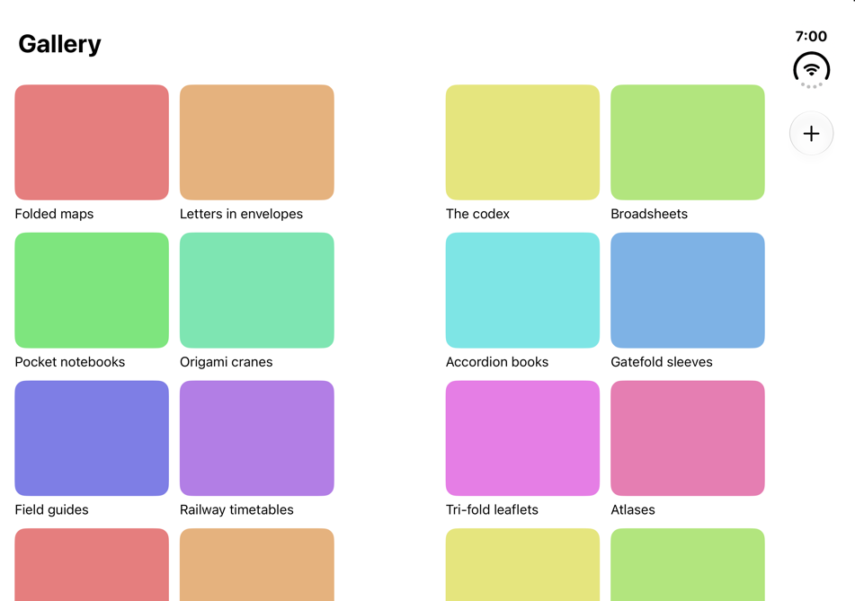

# G4 — Even grid against Fitness

EVAL.md G4: *for each pattern, the matched system app in the same pose shows the same pane assignment and bar
placement*. Even grid's match is Fitness, whose grid keeps its outer margins and widens the spacing at the hinge
(`patterns/even-grid.md`, from [tt-111463 5:12]). Fitness is not on the iOS 27.1 simulator, so under G4 as amended on
2026-10-29 (EVAL.md §1, `docs/history/DEVIATIONS.md`) the reference is set beside Apple's own published frames of Fitness.

- **Fitness**: the tech talk *Strike a pose with adaptive layouts on iPhone Duo* (111463) shows Fitness's Summary on
  the inner display held sideways, first open flat and face-on
  ([5:52–5:53](https://developer.apple.com/videos/play/tech-talks/111463/?time=353)), then folded like a book and seen
  at an angle ([6:01–6:04](https://developer.apple.com/videos/play/tech-talks/111463/?time=361)). The frames are not
  stored here: they are Apple's, as the talks' transcripts are (`docs/history/DEVIATIONS.md`, 2026-10-24). The links open the video
  at the frame.
- **The reference**: `aligned` (`Sources/Patterns/EvenGrid.swift`), captured in `verification/matrices/grid/` at 1 px
  per point, each shot with the catalog's own record of its frames.
- **How it was measured**: the face-on frame was read from the talk's 1920 × 1080 stream, as runs of pixels along a
  row through each row of cards. The display's edge shows as a faint line about 15 px inside the device's rim on all
  four sides, and the bottom row of cards is cut off at it. It encloses 910 × 640 px, so the scale is 0.957 px per
  point for the 951 × 669 pt display, the same across and down. Fitness's tab bar, placed in the 84 pt band as
  Settings places its bar items on the cover, puts the display's trailing edge within 1 px of that line. Figures from
  the frame are good to about ±2 pt. The folded frame is at an angle but symmetric about the crease: the display's
  edges show as the same faint line about 466 px either side of the rim's pinch at the crease, and the display is as
  tall at both outer edges. Its cards stop about 17 px either side of the crease, so the gap at the hinge is centred
  on it and about as wide as the division. Widths in it come from where the cards stop, with the margins as flat, and
  agree with a fit of one plane per half scaled by the row pitch; they are good to a few points. The amendment
  measures face-on frames and no face-on frame of the folded pose was found, so these widths are estimates from an
  angled frame, outside that measurement, and the verdict does not rest on them. Without them the frame still shows
  the leading columns wider: starting at the same distance from the crease, Awards is about 186 px wide and Step Count
  about 147.

## Result
| Pose | Column assignment | Bar placement |
|---|---|---|
| book | **same count and assignment, different widths**: two columns on each side of the hinge, nothing on the fold, the outer margins kept [tt-111463 5:12]. Fitness's cards stop at the division on both sides, so its gutter at the hinge is about the division's 40 pt, and each half's columns take that half's width: about 212 pt leading (wider than flat) and about 171 trailing (estimates from the angled frame). Its rows still line up across the fold: at equal distances either side of the crease the first row of cards spans the same height on both sides and the second starts at the same height. The reference gives all four columns the narrower half's 171.75 pt and puts the leading half's spare width into a 124 pt gutter at the hinge. Fitness's cards span columns (Activity Rings and Trends two wide on the leading side, Fitness+ two wide and two high on the trailing side), each inside one half; the reference's cells are one column each (16–187.75 and 199.75–371.5 · 495.5–667.25 and 679.25–851, so the gutter at the hinge is 371.5–495.5) | **same placement, different items**: a large title at the top of the leading half, a vertical bar on the trailing edge, no bar across the window. Fitness's vertical bar holds its profile under the status cluster and its tab bar (four items) at the foot; the reference's holds a + button under the status cluster and no tab bar |
| flat-sideways | **same count, different spacing and widths**: four columns in both. Fitness spaces its columns evenly, every gutter about 10 pt (the middle one too), each column about 199 pt, its margins about 22 pt leading and 20 pt before the vertical bar, and so centres the grid in the safe area: its middle gutter is at about 434 pt (the window's safe area, x 0–867, has its middle at 433.5 [metrics:flat-sideways]), and the inactive division (455.5–495.5) lies inside its third column (about 440–638 pt). The reference keeps its book layout (16 pt margins, 12 pt gutters, 171.75 pt columns, the middle gutter 371.5–495.5), so folding moves nothing: it takes its even column count from the inactive division [tt-111463 7:50] and keeps its layout through the fold [hig reserved regions: avoid extreme layout changes]. Fitness widens its middle gutter as it folds | as book |
| closed, closed-sideways, laptop, tent, flat-upright | **no oracle**: in the frames looked at (see Limits), Fitness's Summary appears only on the inner display held sideways. The cover appears in *Raise the bar with iPhone Duo* (111462, at 3:34), but with Fitness's Activity page, not the grid | **no oracle** for the grid's screen |

**Where the fold is active, the reference and Fitness agree on the assignment**: two columns a side, nothing on the
fold, the outer margins kept [tt-111463 5:12], the bars in a vertical bar on the trailing edge. **They differ in where
the wider half's spare width goes**: Fitness widens its leading columns (about 212 pt against 171 trailing) and keeps
the gutter at the hinge to the division (the alternative the pattern page weighs under Consequences), and its rows
still line up because its cards' heights do not follow their widths; the reference keeps all four columns at 171.75
pt, so its cells, whose heights follow their widths, line up across the fold, and widens the gutter instead. **Open
flat, they differ again, by a choice the pattern made on purpose**: the reference lays out the flat phone as if it
were folded, so folding moves nothing, while Fitness spaces four columns evenly, about 199 pt each, and changes them
as it folds, the leading pair wider and the trailing pair narrower. The column count is four in both poses and both
apps. No frame of Fitness's grid was found in five of the seven poses.

## Both screenshots
| Pose | Fitness (Apple's frame, linked, not stored) | Even grid |
|---|---|---|
| book | [111463 at 6:01](https://developer.apple.com/videos/play/tech-talks/111463/?time=361) |  |
| flat-sideways | [111463 at 5:53](https://developer.apple.com/videos/play/tech-talks/111463/?time=353) |  |

## Limits
- Apple's frames are renders in a design talk, not captures from a device: one screen in two poses, the folded one at
  an angle.
- G4 asks for both screenshots; Apple's half is a link to the frame, because the frame is Apple's to publish.
- Fitness's Summary is a dashboard of cards in several sizes; the reference's grid is cells of one size. What is
  compared is where the columns and gutters fall and where the bars sit, not the cells.
- The face-on frame's figures carry about ±2 pt, from where the display's edge and the card edges fall. The
  differences the result rests on are well outside that: the middle gutter, about 10 pt against 124; the columns,
  about 199 pt against 171.75; the leading margin, about 22 pt against 16; and the inactive division, which starts
  about 16 pt inside Fitness's third column. The trailing margin (about 20 against 16) clears the error by less, and
  the other gutters (about 10 against 12) differ by no more than it, so that is not a finding. The folded frame's
  widths carry a few points and are estimates outside the amendment's face-on measurement; that the leading columns
  are wider than the trailing ones does not rest on them.
- The frames looked at for this page: 111463 at 5:30, 5:45, 5:52, 5:53, 6:01, 6:04 and 6:15; 111462 at 3:20, 3:34,
  3:50 and 4:00; 111466 at 7:46, 7:54, 8:10, 8:12 and 8:30. The talks were sampled, not watched through. Not looked
  at: 111461, 111464, 111465 (collected as a chapter map only), the group labs, the WWDC sessions not yet pulled
  (`raw/apple-docs/README.md`) and the iPhone Duo product page, which was not collected. The HIG's images were read
  only through their alt text (`raw/apple-docs/hig-designing-for-iphone-duo.md`), which names no Fitness. A frame of
  Fitness's grid in another pose may exist.
