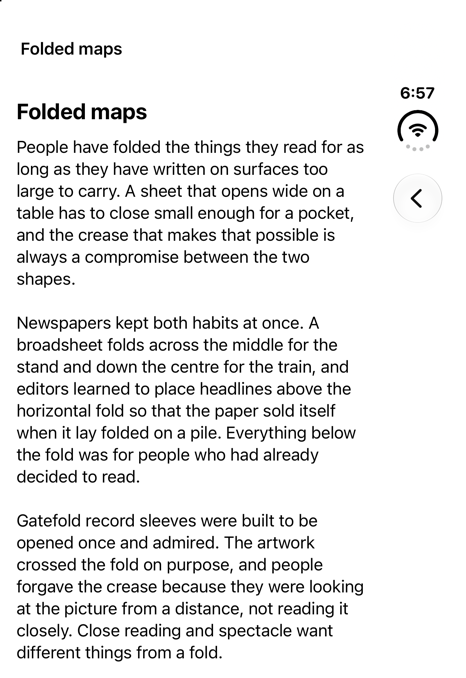
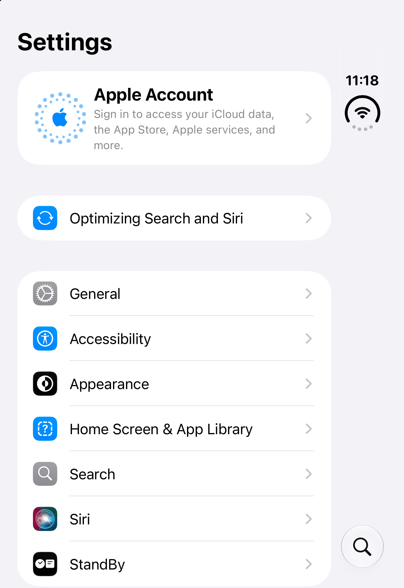
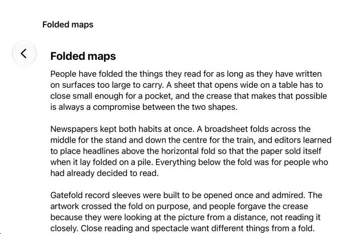
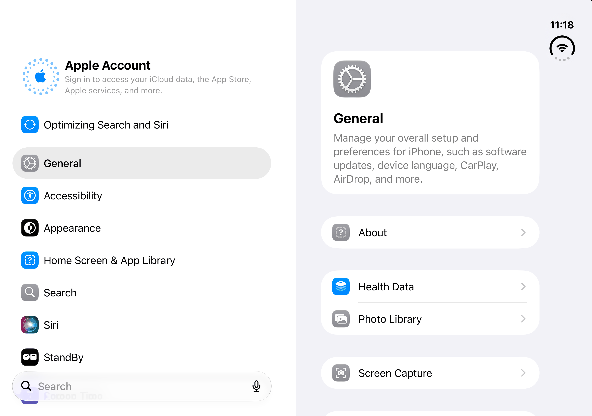
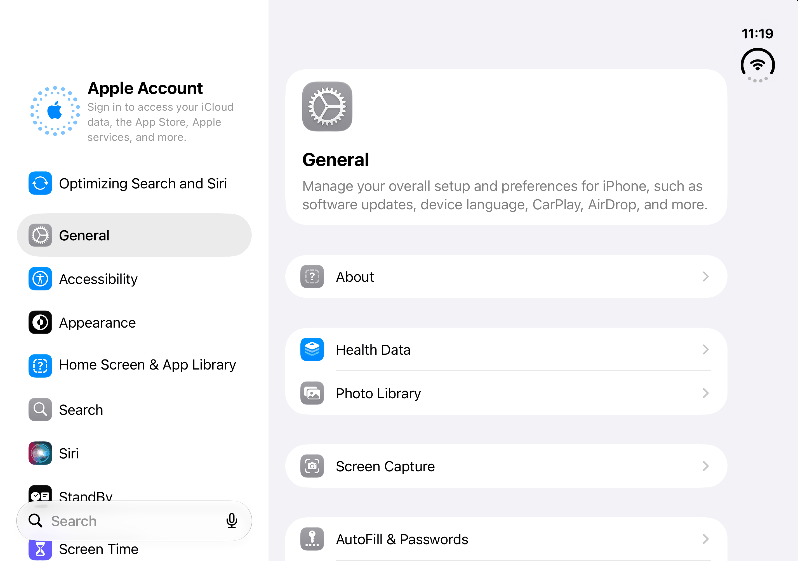
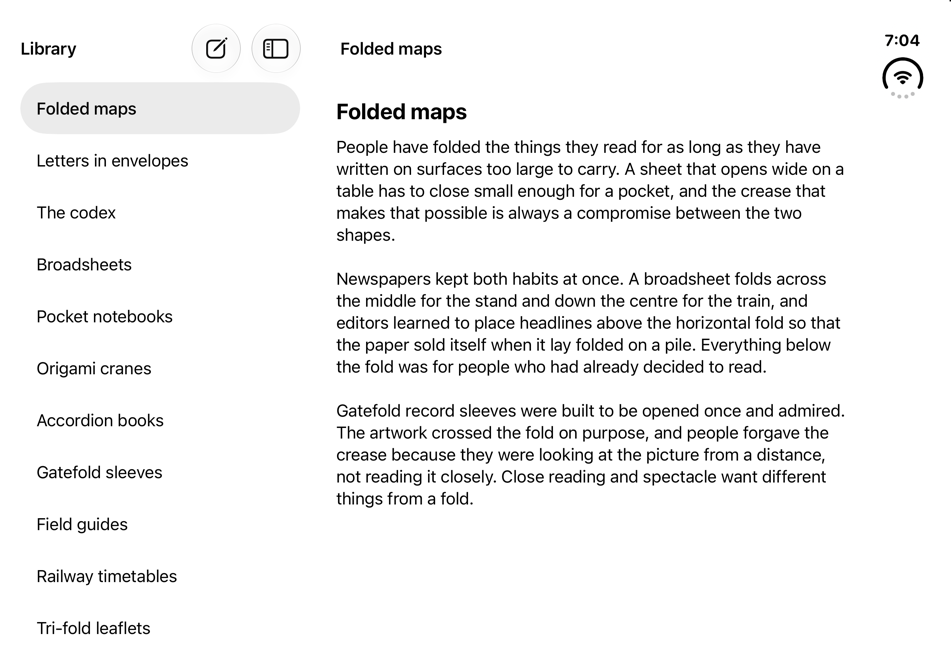
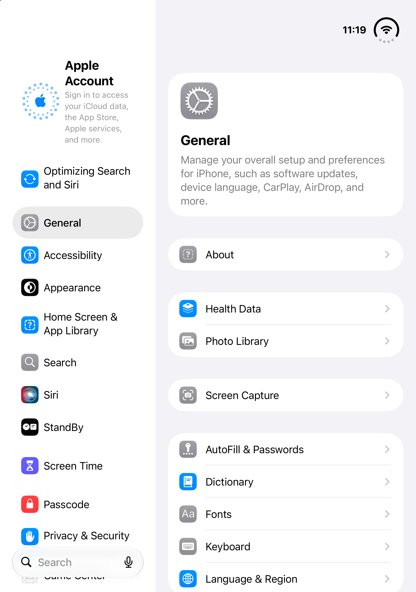
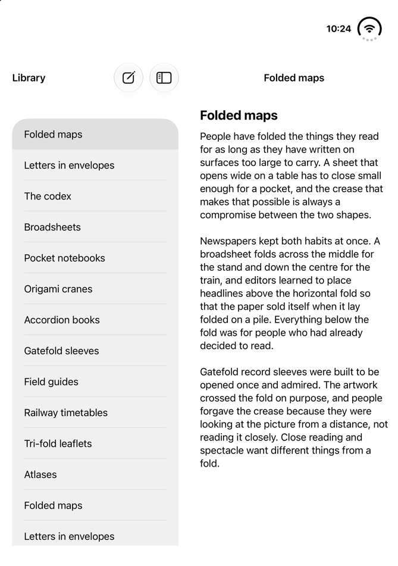

# G4 — Fold-aligned split against Settings

EVAL.md G4: *for each pattern, the matched system app in the same pose shows the same pane assignment and bar
placement*. Settings is the only split view among Apple's apps on the iOS 27.1 simulator (Safari ignores every fold,
`raw/apple-apps/README.md`), so it is the oracle for Fold-aligned split.

- **Settings**: `raw/apple-apps/settings/` (2026-10-25: a fresh simulator, signed out, one screen, no interaction
  between poses; 3 px per point).
- **The reference**: the skill's, `tiled` (FoldAlignedTiledSplit), which it uses for P1 in SwiftUI (SKILL.md step 5).
  It is `aligned` (FoldAlignedSplit) in every pose but laptop, tent and flat upright, where it tiles two panes; the
  shots below show `aligned` where the two have equal frames. The captures are in `verification/matrices/split/` at
  1 px per point, each with the catalog's own record of its frames.
- **How it was compared**: by measuring both. Settings' column boundary is where its background changes colour (it
  draws no separator); the reference's comes from its frame record. One agent compared each pose group and a second
  re-checked every number and citation against the images; the corrections are in the figures below.

## Result
Bar placement has two parts here: the bars the system draws (the vertical bar's band, the bar region at the top of
each column, a tab bar), and the items each app puts in them. The two apps never draw the same items: Settings has
search and no navigation buttons, the reference has Back, compose and a sidebar toggle and no search.

| Pose | Pane assignment | Bar placement |
|---|---|---|
| closed | **same**: one pane from the leading edge to the 84 pt band (x 0–382). Settings shows its list; the reference shows the detail (the catalog starts with an item selected), and the pattern allows either | **same**: the title across the top, bar items in the trailing 84 pt vertical bar under the status cluster, in the same column (x 393–443). Settings' item there is search, at the bottom; the reference's is Back, at the top |
| closed-sideways | **no oracle**: Settings does not rotate on the turned cover (its window stays 466 × 678). The reference turns to 678 × 466 with one pane at x 84–678 | **no oracle**: the reference puts the vertical bar on the leading edge, in the camera's column, which the HIG puts in line with the side controls (`raw/apple-docs/hig-designing-for-iphone-duo.md`, Anatomy); Settings' band reads as a strip along the top |
| book | **same**: two panes, the list leading and the detail trailing, the boundary on the active division. Settings' backgrounds meet at 475.7, the crease's centre; the reference's panes are 0–455.7 and 495.5–867.2, the division's edges. Neither draws content inside 455.5–495.5 | **same bars, different items**: a trailing 84 pt band holding only the status cluster, an 82 pt bar region at the top of each column, no tab bar, no bar across the window. Settings moves search from the cover's vertical bar to the foot of its sidebar (y ≈ 600–645) and leaves its top bars empty; the reference puts compose and the sidebar toggle in its sidebar's top bar and draws nothing at the foot |
| flat-sideways | **same**: two panes, boundary at 320 in both; both ignore the inactive fold | as book |
| laptop | **same assignment, different width**: two panes, list leading, detail trailing. Settings' sidebar is 250.3 pt, the reference's 320 (Settings uses 320 only flat sideways). The boundary is vertical and the fold horizontal in both | **differs**: both draw horizontal bars at the top and no vertical bar or tab bar, but the reference's two navigation bars sit in a row at y 105–154, below the status band, where Settings draws nothing in its top bars and starts its content at y 97. Settings' search is at the foot of its sidebar (y ≈ 880–925); the reference's compose and toggle are in its sidebar's top bar |
| tent | as laptop (both apps draw tent exactly as laptop) | as laptop |
| flat-upright | as laptop | as laptop |

**Where the fold decides the split, the reference and Settings agree.** In book the split sits on the crease, and flat
sideways it ignores the inactive fold; on the cover both collapse to one pane beside the same vertical bar. The system's
bars match in those poses; the items in them never do, since the two apps draw different controls. Upright, the
reference differs from Settings in two ways that have nothing to do with the fold: its sidebar is 320 pt where
Settings' is 250, and its navigation bars take a row below the status band. The item in the cover's single pane
follows each app's state, not its layout. The turned cover has no oracle, because Settings does not rotate there.

`aligned` alone, without the tiled split, shows one pane upright (the detail, with the sidebar behind a toggle), as
the plain system split does. That is why the skill uses `tiled` for P1, and why the upright rows compare `tiled`.

## Both screenshots
| Pose | Settings | Fold-aligned split |
|---|---|---|
| closed |  |  |
| closed-sideways |  |  |
| book |  |  |
| flat-sideways |  |  |
| laptop |  |  |
| tent |  |  |
| flat-upright |  |  |

## Limits
- One screen of Settings, captured fresh. Settings' cover shot was retaken after it had shown General on the inner
  display, so whether its cover would keep an open page cannot be read from it.
- The two apps draw different bar items (Settings: search; the reference: Back, compose, a sidebar toggle), so only
  the system's bars can be compared like for like; the items are described where each app puts them.
- The citations behind each row are Apple's: `raw/apple-docs/hig-designing-for-iphone-duo.md` (split views collapse
  to one pane on the outer display and expand on the inner one; bars move to the side; side controls line up with
  the camera) and the tech talk notes in `raw/apple-docs/` (use the inner display's width for split views; scrolling
  across the fold is fine).
- Even grid and Reflowing columns have no matched app on the simulator (Fitness; Books or Notes). Even grid's page
  sets the reference beside Apple's published frames of Fitness (`even-grid.md`); Reflowing columns' page finds no
  published frame of Books or Notes showing a text in columns and leaves G4 open (`reflowing-columns.md`). Both are
  next to this one.
