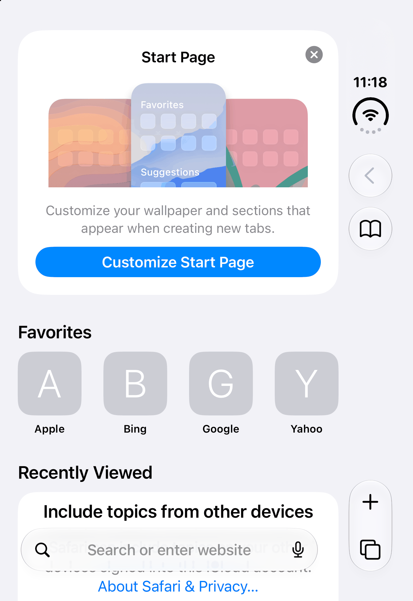
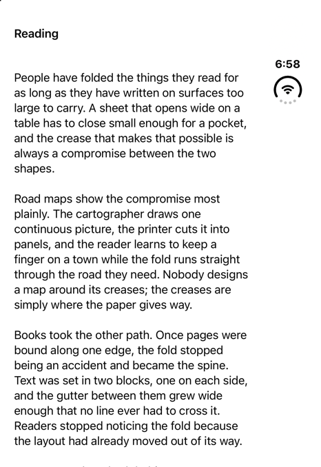
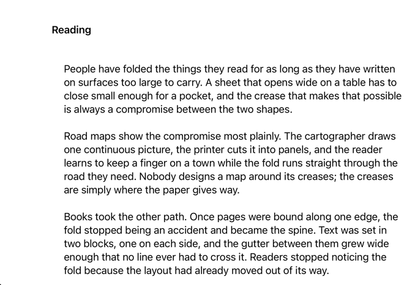
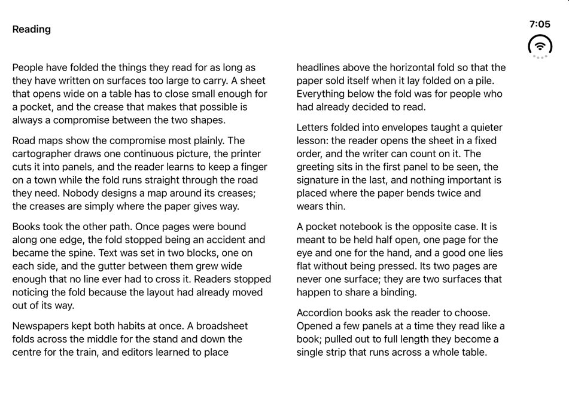
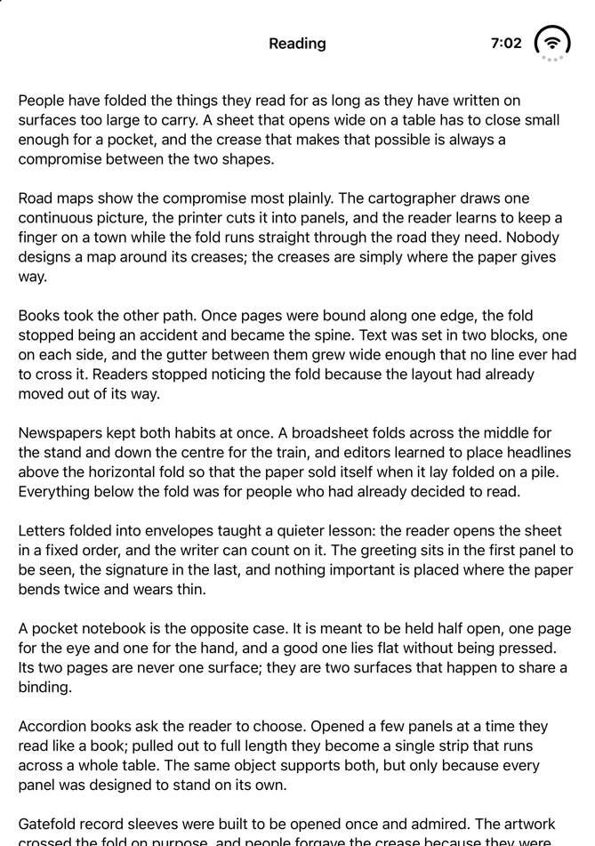

# G4 — Reflowing columns: no matched app to compare with

EVAL.md G4: *for each pattern, the matched system app in the same pose shows the same pane assignment and bar
placement*. Reflowing columns names Books or Notes as its match (`patterns/reflowing-columns.md`). Neither is on the
iOS 27.1 simulator, and under G4 as amended on 2026-10-29 (EVAL.md §1, `docs/history/DEVIATIONS.md`) Apple's own published frames
of them would take their place. **None found shows a text in columns**: Books is in no source collected in
`raw/apple-docs/` and in no frame of the talks looked at for this page; Notes' layout appears in the HIG only as a
split view, a list beside the note, open and folded (in its prose and its images' alt text; the images were not looked
at; its prose also names Notes' New Note action, as one to keep visible longest), and in the notes on *Raise the bar
with iPhone Duo* (111462) only as the example of a toolbar moved into the vertical bar (its Shared bar region chapter,
from 3:09; no frame of Notes was among those looked at); and no frame looked at shows any other app setting one text
in columns on iPhone Duo. G4 for Reflowing columns stays open.

## What Apple shows instead
- **Notes** is in the HIG as a split view: its prose says the split view evens out its panes when the phone is
  folded, and the alt text of the article's images describes the list pane as narrower than the note when the phone
  is open and the two as equal when it is folded (`raw/apple-docs/hig-designing-for-iphone-duo.md`, Reserved regions
  and the image alt text). That is Fold-aligned split's shape, a list beside a page, not a text in columns.
- **Books** is in none of Apple's sources collected in `raw/apple-docs/`.
- **Music** is what *Design for iPhone Duo* (111466) shows for the claim this pattern cites, that the inner display's
  width suits two-column layouts reflowing from one [tt-111466 7:34]. Its album page, at
  [8:10](https://developer.apple.com/videos/play/tech-talks/111466/?time=490), is one column on the cover (the art,
  the title and Play, then the tracks, with a mini player at the foot) and two on the open inner display (the art and
  Play leading, the track list trailing, the mini player across both), with a vertical bar on the trailing edge in
  both. Those are two different blocks side by side. They share this pattern's shape (one column closed, two side by
  side open) but not one text read in order from column to column, nor paging. The page is nearer Arrangement (P4,
  `patterns/DECISION-TABLE.md`). Where Music's blocks fall against the fold was not measured: what was kept is a 360 ×
  270 screenshot of the whole frame at 8:10 and a crop from a 640 × 360 stream at 8:12.
- **Safari**, the one Apple app on the simulator that shows pages to read, was captured on its Start Page only
  (`raw/apple-apps/safari/`). It keeps one column in every pose and draws a horizontal top bar on the inner display.
  In laptop, tent and flat upright that is the reference's shape, one column scrolling across the fold; in book and
  flat sideways its cards run across the fold, the layout this pattern replaces.

## By pose
Safari and Music are not the pattern's matched apps, so their rows are context, not G4 verdicts.

| Pose | The reference (`aligned`) | Nearest Apple frame | Verdict |
|---|---|---|---|
| closed | one column, 20–362 pt; the title inline at the top; no bar items: the trailing 84 pt band holds only the status | Music: one column; back, share and more above its tab bar in a vertical bar on the trailing edge, a mini player at the foot (111466, 8:10). Safari: one column; its controls in a vertical bar on the trailing edge, its address field at the foot | same column and the band on the same edge; the reference puts nothing in it, so the bars differ; neither app shows a text |
| closed-sideways | one column, 104–658 pt; the title at the top; the leading 84 pt band kept clear and empty | Safari: one column; its controls in a top bar, no vertical bar | same column; the bar differs: Safari moves its controls to a top bar, the reference leaves the leading 84 pt empty |
| book | two columns, 20–455.5 and 495.5–847 pt, paged sideways a spread at a time; the trailing 84 pt band holds only the status (no bar items) | Notes, folded (HIG, described only): a list beside the note, the two equal. Safari: its cards cross the fold, under a top bar, no vertical bar | **open**: Notes is described only as a list beside a note, Fold-aligned split's layout; no frame of a text in columns, none of Books |
| flat-sideways | as book | Notes, open (HIG, described only): the list narrower than the note. Music, open: the art leading, the track list trailing, a vertical bar on the trailing edge. Safari: as book | **open**, as book |
| laptop, tent, flat-upright | one column, 20–649 pt, scrolling across the fold; the title inline at the top, no bar items | Safari: one column scrolling across the fold, its bar at the top | same column, the bar region at the top in both (the reference's holds only its title and the status); Safari's content is its Start Page, not a text |

**The poses that make this pattern, book and flat sideways, have no Apple frame of a text in columns.** Where the
reference keeps one column (the cover, turned or not, laptop, tent, flat upright), its one column matches the one
column of Safari's Start Page (Safari was not seen with a text open). The reference has no bar items. It keeps the
system's 84 pt band clear for a vertical bar: the band holds only the status on the cover and the open display, and
nothing on the turned cover, where Safari moves its controls into a top bar. In book and flat sideways the band is on
the trailing edge, where Music, open, has back, share, more and its tab bar, and Safari draws a top bar instead; the
items are not compared, since the reference has none. Music's album page has this pattern's outline, not its content.

## Both screenshots
| Pose | Apple | Reflowing columns |
|---|---|---|
| closed | [Music, 111466 at 8:10](https://developer.apple.com/videos/play/tech-talks/111466/?time=490);  |  |
| closed-sideways |  |  |
| book | no Apple frame of a text in columns;  |  |
| flat-sideways | [Music, 111466 at 8:10](https://developer.apple.com/videos/play/tech-talks/111466/?time=490);  |  |
| laptop |  |  |
| tent |  |  |
| flat-upright |  |  |

## Limits
- The frames looked at for this page: 111463 at 5:30, 5:45, 5:52, 5:53, 6:01, 6:04 and 6:15; 111466 at 7:46, 7:54,
  8:10, 8:12 and 8:30; 111462 at 3:20, 3:34, 3:50 and 4:00 (not its Notes example in the chapter from 3:09). Nothing
  between them is recorded as seen. Other Apple
  material may show a reading app: the rest of the talks, the group labs, the WWDC sessions not yet pulled
  (`raw/apple-docs/README.md`) and the iPhone Duo product page, which was not collected.
- The HIG article's images were not viewed; only their alt text, in `raw/apple-docs/`, was read.
- Safari was captured on a fresh simulator, on its Start Page, with no page open, so how it lays out an article is not
  known from it in any pose; the rows that set the reference beside Safari compare its text with the Start Page's
  cards.
- Books and Notes, the apps the pattern page names, have not been seen on an iPhone Duo: Books not at all, Notes only
  through what `raw/apple-docs/` says of it (the HIG's prose and its images' alt text, and 111462's notes).
